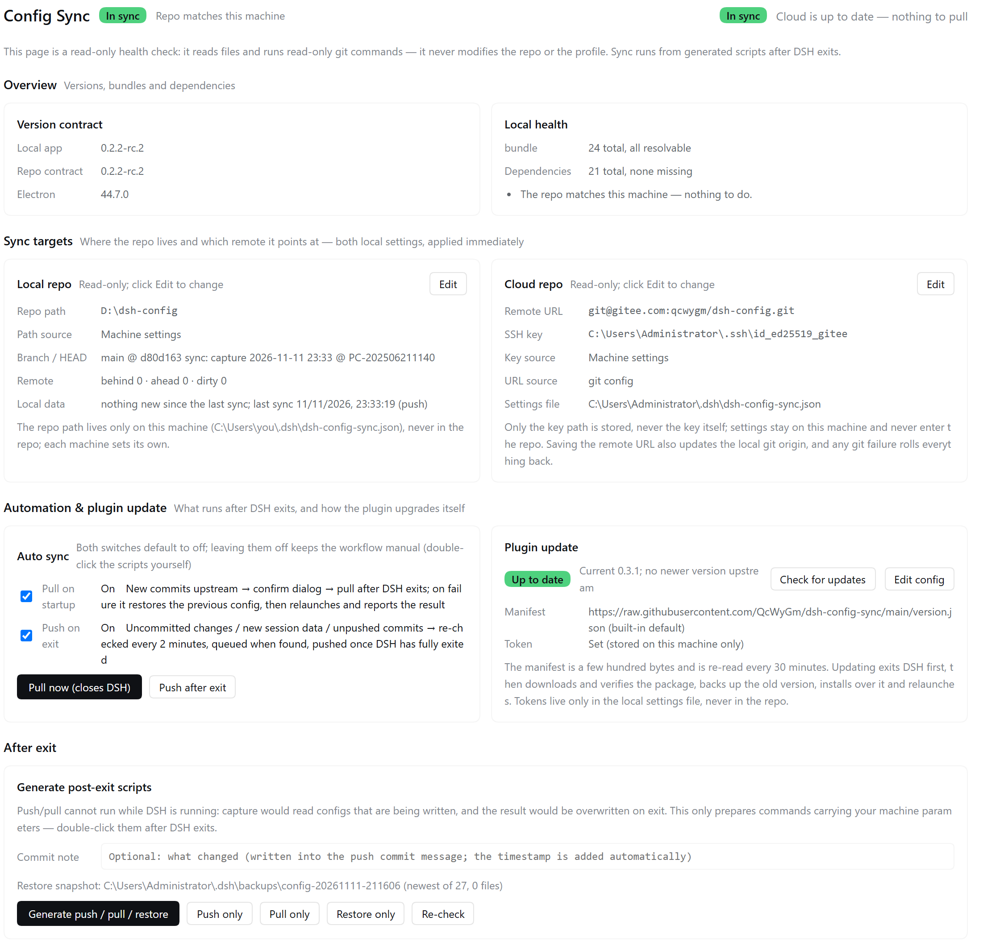

# dsh-config-sync

[中文](README.md) | English

A DSH plugin: it adds a **"Config Sync"** row to the sidebar (opening a full-page health-check panel), plus a summary row under **Settings → General**. It only **inspects and prepares commands** — the sync actions never run inside the app (except the automatic sync that relaunches the client).



> The screenshot is from 0.3.14; the section layout is unchanged. Every card is now "read-only + Edit" - see "Consistent interaction" below.

The UI is bilingual: it follows the client language (`zh-*` → Chinese, anything else → English), with no settings toggle. Only the generated `.cmd` scripts keep Chinese text, because they are local shell helpers.

> `README.md` (Chinese) is the trimmed, current reference; this English file mirrors the older per-version notes and keeps the same facts.

## From scratch: bring up the second machine

Two commands per machine: the source machine pushes once, the target machine pulls once. The order below is what the isolated end-to-end run actually walked through on 2026-11-14 (two fake clients + a local bare repo, main machine untouched).

```
Source A                          Remote (Gitee / GitHub / …)       Target B
──────────────────────────────    ────────────────────────────    ─────────────────────────────
1 install the plugin                                               1 install the SAME client version
2 set local repo + remote URL                                      2 launch it once so profiles\desktop exists
3 first push = "initial push"   ──►  skeleton + configs  ──►        3 install the plugin, set the same repo/remote
   (writes the 6 runtime scripts)                                  4 first pull (it overwrites local configs)
                                                                   5 start the client: workspaces + sessions are there
```

### Prerequisites (each one was actually hit)

| Item | Requirement | When missing |
|---|---|---|
| Client version | Same on both machines (checked via `profile\host-contract.json`) | `version mismatch` in the pull log; only `-AllowVersionDrift` forces it |
| Target `.dsh` | The client must have run at least once, so `profiles\<profile>` exists | `[X] target profile does not exist (DSH never installed here?)` → pull aborts |
| Node / Electron runner | Ships with the client (`<AppRoot>\node.exe` or `DeepSeek Harness.exe`) | `no usable built-in runtime`, session cwd is not rewritten → **the session list stays empty** |
| Repo skeleton | Written automatically by the source machine's initial push | A repo with only `settings\` and no `apply.ps1` cannot run on B; redo the initial push |
| git | Installed on both (in PATH or a common location) | `git.exe not found` |

### Source A: first push (initial push)

Set **Local repo** (an empty folder or an existing repo) and **Cloud repo** (the remote URL), then press the initial-push button (it reads "initial push" when both sides are empty).

It runs: `git init` → add `origin` → **copy the plugin's 6 runtime scripts (`apply.ps1`, `capture.ps1`, `sync.ps1`, `restore.ps1`, `post-exit.ps1`, `dsh-sync-common.ps1`) plus `tools\fix-session-cwd.mjs` into the repo root** → write `profile\host-contract.json` → `capture` → commit → `push -u origin main`.

Command-line equivalent:

```powershell
pwsh -File runtime\sync.ps1 push -RepoRoot <repo> -DshHome <~\.dsh> -AppRoot <client root> `
  -WorkspaceHome <workspace root> -ProfileName desktop -SkipInstall -Force
```

Real output of the isolated first push (15 files, commit `3fa3780`): the 6 scripts + `tools/fix-session-cwd.mjs`, `profile/{package.json,cordis.patch.yml,host-contract.json}`, `settings/dsh-workspaces.json`, `workspace/workspace-registry.json`, `workspace/default-workspace/notes.md`, `conversations/session-index.json`, `conversations/session_projcache/s1.json`.

### Target B: first pull

1. Install the **same** client version and **launch it once** (only to create `profiles\desktop`; you can quit right away).
2. Install the plugin, set **Local repo** (an empty folder is fine) and **Cloud repo** (same URL).
3. Press pull. It first reports "local is N commits ahead / N uncommitted" and asks for confirmation (it overwrites local configs).
4. After it finishes, check three things: workspaces are listed, opening an old session lands in the right workspace, plugin dependencies are complete.

```powershell
pwsh -File runtime\sync.ps1 pull -RepoRoot <repo> -DshHome <~\.dsh> -AppRoot <client root> `
  -WorkspaceHome <workspace root> -ProfileName desktop -SkipInstall -Force
```

`-SkipInstall` skips `pnpm install` (required offline / in isolation); `-Force` bypasses the "DSH is running" guard (on a real machine quit the client properly instead).

Real output of the isolated pull (`pull_rc=0`):

```
[OK] host versions match (app = 0.2.2)
[OK] workspace "default-workspace" restored → <B>\app\workspace\SquadLink (1 file, byte-exact)
[OK] workspace registry merged by id → <B>\home\storages\workspace.json (1 workspace)
[OK] session projcache cwd aligned to this machine: fixed 1
[OK] session data restored: 1 written, 1 backed up
[OK] all 0 plugin dependencies in place
```

### The five things that trip up a from-scratch run

| Symptom | Cause | Fix |
|---|---|---|
| `-AppRoot mismatch, switched to D:\DeepSeekHarness` | `Resolve-DshAppRoot` only accepts a folder containing `resources\app.asar` or `resources\app\package.json`; a fake/portable client falls back to the registry install | make sure the folder passed to `-AppRoot` has one of those |
| `[X] stopped (nothing captured, nothing committed)` | `DeepSeek Harness.exe` is running, so `cordis.patch.yml` may be half-written | quit fully (tray included), or use `-Force` |
| `target profile does not exist` | the target `.dsh` was never initialised by the client | install the same client version and launch it once |
| `no usable built-in runtime` | no `node.exe` / client binary under `<AppRoot>` | install the full client, otherwise session cwd is not rewritten and the session list is empty |
| workspace files arrived but custom keys in `~\.dsh\settings.json` did not | plugin configs are a **whitelist** (13 files), `settings.json` is never copied whole | check whether the config belongs to that whitelist |


## Install

The plugin is a standard DSH bundle; install it into the current profile:

```sh
# Install from this repo's release package (no build needed: host, client and runtime scripts are already inside)
dsh plugin add https://raw.githubusercontent.com/QcWyGm/dsh-config-sync/main/releases/dsh-config-sync-<version>.tgz   # latest on the Releases page
```

Or add this repo's index under the official **Plugins → Discover → Index sources** (see "Using this repo as a market index source" below). **The third-party market plugin dshmarket does not read that index** — see that section for why.

After installing, point it at your own config repo (common paths are auto-detected by default). The **Plugin update** card asks for a manifest URL and token only when needed — **this repo is public, so updates work without a token**.

`apply.ps1` does three things on install: it unpacks `local-plugins\dsh-config-sync-<version>.tgz` into `<AppRoot>\dsh-config-sync-0.1.0`, adds a `link:` dependency and a `dsh.profile.bundles` entry to `package.json`, and a `config-sync` line to `cordis.patch.yml`.

## Contents

| Path | Purpose |
|---|---|
| `index.js` | Host half: `/config-sync/status`, `/prepare`, `/settings`, `/auto`, `/update` routes |
| `client.js` | Browser half: sidebar row, panel, settings summary row |
| `cordis.patch.yml` | Bundle patch layer (`id: config-sync`) |
| `runtime/` | The six post-exit PowerShell scripts plus `fix-session-cwd.mjs`, shipped with the package so scripts can be generated right after install without cloning the config repo first |
| `tools/` | Self-test `selftest.mjs`, client structure check `clientcheck.mjs` |
| `version.json` / `releases/` | Self-update manifest and package |

## Where the entries hang

| Entry | slot | Notes |
|---|---|---|
| Sidebar row | `sidebar.panellist` (`id: config-sync`) | Same column as "Plugins / Automation / Skills / Memory", double-arrow icon |
| Opened panel | `main` (`key: config-sync`) | The host binds both by id/key, so the two registers must be done in one **nested inject** (injecting only `main` makes the `sidebar.panellist` register a no-op) |
| Settings summary row | `settings.general.item` | One four-state chip row plus an expandable body (repo, remote, key) |

Click-to-switch on the sidebar row is handled by the host; the contract is copied from `dshmarket` / `dsh-mnemon`.

## What the panel shows

The layout is "one status row + one metric strip + section cards", read top to bottom (since 0.3.14, see `docs/panel.en.png`):

**Title row**: `Config Sync　local [In sync / To push / To pull / Problem]　cloud [In sync / Out of sync / To pull]`, with a "Re-check" button on the right. Both badges share one palette — green = in sync, orange = to push / to pull, red = problem; the local one only talks about this machine (config completeness, missing dependencies, uncommitted/unpushed state), while the cloud one is **fully automatic**: checked when the panel opens and re-checked every 2 minutes, **no button**.

**Meta row**: `app version / Electron version · branch @ short HEAD`. It replaces the paragraph of intro text that used to sit under the title.

**Metric strip**: five cells at a glance — `App / contract` (turns orange when they disagree), `bundle` (red when something is unresolvable), `Dependencies` (red when something is missing), `Snapshots` (count) and `Last sync` (time, with `(+N)` for files written after it). A "to-do" card appears below only when there is something to fix.

**Sections**: Overview (strip + to-do) → Local paths (since 0.3.30: cross-machine root confirmation and the pending list; since 0.3.34 a read-only view with an Edit button; since 0.3.37 **the whole section stays hidden** and only expands from the "Local paths" button in the title row (which turns amber with a count when something needs review)) → Sync conflicts (only when there really are some) → Sync targets (Local / Cloud repo) → Automation & plugin update → After exit → Restore backup → Sync content → Feedback (since 0.3.31). Two columns on wide screens, and each card keeps text to "one value line + one grey hint line" instead of long prose.

**Consistent interaction**: Local paths / Local repo / Cloud repo / Auto sync / Plugin update / Sync content all start **read-only** and unlock on Edit; Save commits, Cancel drops the draft. Only cards that were never configured (no repo, no remote) stay in edit mode with no Cancel - without those values nothing can be pushed, pulled or generated. The Local paths card is also forced into edit mode when no root was detected at all.

**"To push" is not just git**: even with a clean `git status`, new sessions/materials may still sit in `~\.dsh` uncaptured. So `sync.ps1` writes `~\.dsh\config-sync-state.json` (`lastSyncAt`/`mode`/`head`) after a successful push/pull, and `status` returns an extra `local` block: it stats `sessions`, `skills`, `.agent-presets`, `mnemon`, the five profile files and registered workspace directories, counting anything whose **mtime is later than `lastSyncAt`** into `local.pending`, which turns the badge orange "To push". mtime only — no content reads, no capture; capped at 20,000 files / 1.5 s; copies and "save as" count too, and a false positive only costs one extra hint.

**"To pull" = the local repo is still empty while the cloud has content** (since 0.3.26, cloud dimension since 0.3.35): on a new machine, pointing the repo path at an empty folder is the normal "waiting for the first pull" state, **not an error** — the badge is orange "To pull" instead of red "Problem", and the to-do line says Pull brings the repo content down into that path.

**"To initialize" = both the local repo and the cloud are empty** (since 0.3.35): the badge is orange "To initialize" and Push becomes **Initialize push** — Pull stays disabled because there is nothing to pull.

**Last auto-sync result**: if `~\.dsh\auto-sync-result.json` is within 15 minutes, a 5-second toast pops **as soon as the client starts** (`apply()` checks `status` 1.5 s after mount, appends its own overlay to the body, so it shows without opening the panel; success/failure + reason + log path on failure). The line inside the panel shares the same predicate and the same localStorage key, so one result pops only once.

## Local repo / cloud repo (both configurable, read-only by default, forced when unset)

- Repo test: the directory has both `apply.ps1` and `profile\package.json` (plus `sync.ps1` to actually push/pull).
- Priority: local settings file → plugin config `repoPath` → `DSH_CONFIG_REPO` → auto-detected common locations. **An empty folder configured explicitly counts as a valid answer** and is not displaced by another auto-detected repo.
- Four phases (`repo.phase` in `status`): `ok` a real repo, `empty` an empty folder waiting for the first pull, `missing` the folder does not exist, `unusable` it holds other things and does not look like a repo. `repo.pushAllowed` / `repo.pullAllowed` derive from it, and the panel buttons and host routes share that one source of truth.
- **An empty folder allows pull only when the cloud has content (since 0.3.26, cloud dimension since 0.3.35)**: when the path points at an empty folder and the cloud already has branches, the panel enables Pull (plus Restore) and greys out Push with a "pull first" hint; the host rejects `prepare(push)` and `auto(push-now)` with 400; "Generate …" degrades to pull + restore.
- **An empty folder plus an empty cloud allows push only, and that push *is* Initialize push (since 0.3.35; it actually finishes since 0.3.42)**: the button reads "Initialize push" and Pull is greyed out (nothing to pull). `status` gains `repo.remoteHeads` (branch count, `null` = undeterminable), `repo.remoteEmpty` and a three-way `repo.mode` (`ok` / `await-pull` / `await-init`). `sync.ps1 push` then runs: `git init` → add `origin` → **write the repo skeleton** (copies `apply.ps1` / `capture.ps1` / `sync.ps1` / `restore.ps1` / `post-exit.ps1` / `dsh-sync-common.ps1` from the plugin runtime into the repo root, plus `tools\fix-session-cwd.mjs`) → write `profile\host-contract.json` (this machine's client version) → `capture` → commit → `push -u origin main`. The skeleton has to come along, otherwise the remote becomes a half repo (settings but no execution bodies) that the next machine cannot run.
- **0.3.42 fixes the two traps that stopped Initialize push halfway**: (1) `capture.ps1`'s outside-root path report was missing a `$` — `(v.Replace(...)` made PowerShell look for a command named `v.Replace`, which only fires when the config has a custom root, and the whole push died with `无法将"v.Replace"项识别为 cmdlet`; (2) `sync.ps1` treated "the repo folder is not empty" as "you typed the wrong path", but during an Initialize push `capture` has just written 16 config items into that folder — so it blocked itself with its own output and exited. The test is now "the folder holds this plugin's own scripts (`dsh-sync-common.ps1` / `sync.ps1` / `capture.ps1`, any one of them) → it is a sync repo"; only a genuinely wrong path (Desktop, Downloads) is rejected.
- "Does the cloud have content" is computed live with `git ls-remote --heads <remote>` (15 s timeout): **if it cannot be determined (offline / auth failure) the old rule applies and only Pull is enabled** — no push on a blind reading. If the cloud already has branches while the local folder is still empty, `push` is refused with a "pull first" message, because pushing would graft this machine's state onto a history already in use.
- Only this plugin's own `同步-*.cmd` files and hidden entries (`.git` etc.) count as "empty"; a folder holding other files yet not looking like a repo is `unusable`, the panel asks you to reset the path, and saving the setting is refused too.
- Cloud: the remote URL comes from `git remote get-url origin` first, falling back to the settings file; the SSH key stores only a **path** and may be empty to let `.ssh\config` decide.
- **Never configured = forced setup**: the card stays in edit mode with no "Cancel", a red line at the top, the generate buttons disabled, and the host's `prepare` returns 400 (restore is unaffected when only the remote is missing).
- Save order: validate (URLs accept only `git@host:path` / `ssh://` / `https://`; a key that is filled in must exist) → write settings → `set-url` if `origin` exists, `remote add` if not → on git failure roll the settings file back, so the panel never shows A while git uses B.
- A configured path that later goes away (moved/renamed): `status` returns `repo.exists=false` with `phase='missing'`, and the panel returns to "must be set again" — it will **not** silently switch to another detected repo.
- Stored in `~\.dsh\dsh-config-sync.json`: per machine, never in the repo.

## Supported cloud hosts (spelled out since 0.3.27)

The plugin does not pick a git host: the remote URL is only validated for its *form*, and `fetch` / `push` / `pull` / `ls-remote` are handed straight to git. Gitee, GitHub, GitLab and self-hosted Gitea/Forgejo all take the same path.

| Item | Detail |
|---|---|
| URL forms | `git@host:owner/repo.git`, `ssh://git@host:port/owner/repo.git`, `https://host/owner/repo.git` |
| Default branch | `main` is tried first; if the remote has no `main`, the first remote branch is used (`master` on older repos), and tracking is set up after the pull |
| Auth | SSH: fill in the key path (empty lets `.ssh\config` or Git defaults decide), and generated scripts use `GIT_SSH_COMMAND` with `StrictHostKeyChecking=accept-new`; HTTPS: use the account/token in Git Credential Manager — the plugin stores no passwords |
| Failure hint | On a failed fetch/pull the self-check host is read from the real `origin` URL (since 0.3.27) instead of a hard-coded `git@gitee.com`; an https URL gets the `ls-remote` check, not `ssh -T` |
| File size cap | 100MB (Gitee free tier, GitHub and GitLab all default to roughly this), and larger files are left out of the repo |

Two notes for private repos: ① SSH is the simplest; ② the plugin's **own update manifest** points at the author's public repo by default — if you repoint it at your own private repo, only Gitee raw links are currently rewritten to the API + token form, so anonymous raw reads of a private GitHub/GitLab repo will fail. That is a known limitation.

## Workspaces and sessions follow the machine too (projcache cwd fixed in 0.3.44)

Whether a workspace and its sessions work on a new machine depends on three paths being rewritten to this machine's value:

| Where | What it stores | What happens on another machine |
|---|---|---|
| `workspace\workspace-registry.json` | each workspace's location, already written as a `{{APP_ROOT}}/xxx` placeholder | expanded to this machine's path on pull, so the workspace opens in the right folder |
| `conversations\sessions\--ws-<id>--\...\session.v4.jsonl.zstd` | the `cwd` in the first frame of the session log | the first frame is rewritten from "where is this workspace on this machine" (only that frame - the rest of the file is untouched) |
| `conversations\session_projcache\<sessionId>.json` | `record.identity.cwd` | **since 0.3.44** rewritten by looking the session's workspace up through the registry's `sessionIds`; this step used to be missing, so a workspace listed fine but its history still pointed at the other machine's folder |

So "the original machine's location becomes this machine's location" is inferred like this: the registry tells you the workspace's title/slot and its shape under `{{APP_ROOT}}`, which expands to an absolute path here; sessions claim the same workspace through `sessionIds` and follow that location - never by guessing a drive letter. If it cannot be inferred (the registered path is a bare old drive path, or there is no matching entry), nothing is rewritten: the panel reports it instead of writing a guessed path.

The report produced on push is split into two groups: `scope: config` for paths inside config files, `scope: data` for records under `workspace\` and `conversations\` that still point at the other machine. The panel lists them separately ("Paths inside config files" / "Paths in workspace / session records"), and both can be accepted row by row.

## New sessions land in the default workspace (since 0.3.28)

A finished sync brings DSH back up, and the client opens a fresh session on startup. Where that session lands is decided by `global.defaultWorkspaceId` in `<DshHome>\storages\workspace.json` — and DSH writes that value only during **first-time initialization**, so after a few syncs it can be left pointing at whatever workspace was used last.

Since 0.3.28, `post-exit.ps1` corrects that value **after the client has fully exited and before it is relaunched**. The timing is not cosmetic: the client owns that registry and writes it back on exit, so anything written earlier is lost.

| Item | Detail |
|---|---|
| Default behaviour | Auto-detect the workspace titled `default-workspace` (or whose path ends with `\deepseek-harness\default-workspace`) and point `defaultWorkspaceId` at it |
| Targeting another one | Set `defaultWorkspace` in `~\.dsh\dsh-config-sync.json` to a workspace ID or an absolute path |
| Turn it off | Set the same field to `off` (or `none`) |
| Safety | Only written when the value actually differs; the original is backed up as `workspace.json.bak-<timestamp>` first; the result is read back and checked (value plus workspace count); a path matching no workspace is skipped, never guessed |
| Side effect | A default workspace you switched by hand gets pulled back to `default-workspace` on the next sync — set `off` if you don't want that |
| Undo | Copy `workspace.json.bak-<timestamp>` back over `workspace.json` |

## The scripts generated in one click

"Generate push / pull / restore" can write all three at once, or one of them; when the local repo is still empty it generates pull + restore only. File names, buttons and the script text are Chinese by design.

| Script | What it does | Safety valve |
|---|---|---|
| `同步-推送.cmd` | capture this machine's config after exit and push it | first checks whether `DeepSeek Harness.exe` is still running; refuses outright when the local repo is an empty folder |
| `同步-拉取.cmd` | pull from the remote after exit and apply locally | same; **states how many commits ahead / uncommitted items first, and requires `y`** — it overwrites local config with the repo version |
| `同步-还原.cmd` | roll the profile back to the snapshot taken before a given apply | same; **runs `-DryRun` to print the plan first, writes only after `y`** |
| `同步-还原-<snapshot name>.cmd` | the same, but rolling back to **that specific snapshot** (generated by a row in the "Restore backup" card) | same; the file name carries the snapshot name, so several can coexist without overwriting each other |

All three bake in this machine's parameters (repo, AppRoot, `.dsh` location) and can be double-clicked. Pull and restore accept `--yes` to skip confirmation (for automation/remote control); with no confirmation they say plainly "no confirmation (y) received, exited: nothing changed on this machine" instead of exiting silently.

- **Commit note**: optional when generating the push script; passed as `-Message "..."` to `sync.ps1`, and **the timestamp is appended at run time**. Empty means the default `sync: capture <time> @ <machine>`.
- **Which restore snapshot**: if a snapshot exists at generation time it is written into `-BackupDir` explicitly (with time and total count); if not (fresh machine, plugin just installed) it is **left out** and `restore.ps1` picks the newest at run time — otherwise the script would stick to "there was no snapshot when it was generated". If the newest one turns out to be an empty snapshot, it walks back to the first one containing `package.json` and says so. Clicking a row in the "Restore backup" card uses the same generator and simply writes that snapshot's absolute path as `-BackupDir`, with the snapshot name in the file name.

## Sync conflicts (since 0.3.17; both copies backed up since 0.3.18)

When a pull is blocked by local files (the same path exists locally with different content), git aborts the whole batch. The old behaviour — "on failure, `reset --hard` and restore the latest snapshot" — actually knocked the **already fast-forwarded** HEAD back to the old commit, so the repo stayed permanently a few commits behind and every retry failed. 0.3.17 stops resetting:

1. `sync.ps1 pull` runs `git fetch`, checks whether a fast-forward is possible, then intersects `git diff --name-only HEAD origin/x` with (local untracked ∪ local modified). On a hit it **backs up both sides** of every file and writes the list to `~\.dsh\sync-conflicts.json` (kind, both sizes, binary flag, 1500-char preview each side, whether each copy was saved), then `exit 6`. The repo and the local config are left untouched; HEAD is not rolled back.
   The backup folder is named to say what it is: `~\.dsh\backups\conflict-<time>-拉取冲突-Pull-conflict\`, containing
   - `本机-Local\<relative path>` — the local version (exactly what was in the working tree);
   - `云端-Cloud\<relative path>` — the cloud version (`git show origin/x:<path>`; written byte-exact through `git cat-file blob` + a redirection, so `.zstd`/`.tgz` binaries are never re-encoded);
   - `说明-README.txt` — bilingual (Chinese/English): created time, repo, HEAD before the pull, remote ref and sha, item count, what each folder holds, and both ways to restore;
   - `清单-Conflicts.json` — a snapshot of the list, so you can check later which options were offered and which side was picked.

   If a copy's written size does not match the source, the script warns, marks that side as not saved, and the panel greys out the matching button — no "thought it was backed up" surprises.
2. `runtime\post-exit.ps1` treats exit code 6 as "pull pending" and skips the rollback branch.
3. After the client restarts, a "Sync conflicts" card appears under the metrics (hidden when there is no list):
   - one row per file, **click the row itself** to expand/collapse both previews (no separate "details" button);
   - "Keep local / Use cloud" per row, plus "All local / All cloud" at the bottom;
   - when expanded, two buttons: "Restore local copy" and "Restore cloud copy" — **either copy can be written back to the working tree independently, they never overwrite each other, and neither touches git history**; a copy that failed to save greys out its button and says why;
   - "Save" writes the choices into the list, "Discard" deletes the list (the next pull recomputes it).
4. Save, then click "Pull now": `sync.ps1` reads the same list, deletes the working-tree copy for every `cloud` item (and also for `local` items, so git can fast-forward), fast-forwards, then writes the `local` items back from the backup — they become a normal local change that the next push carries. The list is then removed.

Granularity is only "keep local / use cloud per item" plus "restore one item from the backup"; there is no in-preview editing or manual merge. Conflicts are almost always "the other machine changed the same config file", where picking one side is enough — for a real merge, edit the file and push.

API: `GET/POST /config-sync/conflict` (GET reads the list, each item carrying `localSaved`/`cloudSaved`; POST `{items:[{path,choice}]}` saves choices, `{action:'restore',path,side:'local'|'cloud'}` restores one file (local by default), `{action:'reset'}` discards the list). A restore writes into the `repo` recorded in the list, so changing `repoPath` later cannot point it at the wrong repo. `status` now returns `conflicts: {exists,total,pending,at,backupDir}`.

## Restore backup (since 0.3.13; "Restore now" + point-in-time since 0.3.25)

The panel has a "Restore backup" card (placed after "After exit" and before "Sync content"): the top row is the **backup folder** (default `~\.dsh\backups`, where `apply.ps1` takes a snapshot before every pull/apply), and below it every **snapshot in that folder** is listed — name, time (plus a relative time such as "3 min ago"), how many plugins it holds, and whether it can be restored.

- **No sizes in the list (since 0.3.41)**: each snapshot is a whole profile (thousands of files). Older builds re-walked every snapshot on every panel refresh — 92 snapshots / 48k files measured 7.7 s, pushing `/config-sync/status` to 11 s; a single front-end fetch could not survive that and showed "read failed" until you clicked "Recheck" by hand. The list now shows name / time / plugin count / restorability only; sizes belong in Explorer. The same change also: caches the remote probe for 5 minutes, caps each probe at 2.5 s, warms it up when the plugin loads, and gives the front-end status call a 15 s timeout plus 3 automatic retries (the message says "retried 3 times"). Measured status went from 8.0 s to 0.35 s (median over 20 calls).

- **Since 0.3.25 this is the same pipeline as "Pull now"**: clicking "Restore now" on a row first asks the host for a **diff preview** — which plugins installed after that snapshot will be removed, which files created after it will be moved out, which files will be overwritten / written back, and which plugins will be re-installed — and only "Confirm restore" queues it: the client closes normally, `post-exit.ps1` opens a visible progress window running `restore.ps1 -RollbackToPoint`, the result is written to `auto-sync-result.json`, and the client restarts automatically. No more quitting the client yourself, double-clicking a `.cmd` and typing `y`.
- **Point-in-time means rolling back to that moment**, not just copying the snapshot files back: files created after the snapshot move into `backups\manual-<timestamp>\rollback\files`; plugins installed afterwards lose only their junction link (never deleting through it into the real directory) or have their real directory moved into `rollback\plugins`; every item is recorded in `rollback\rollback-manifest.json` — all restorable, nothing physically deleted. The current config is saved first as `manual-<timestamp>` as well.
- **What counts as "a plugin installed after the snapshot"**: the `dependencies` of the restored `package.json`. Direct children of `node_modules` (including `@scope/pkg`, but not `.bin` / `.pnpm`) that are not in it get removed, and `pnpm install` afterwards adds back whatever the snapshot had.
- **The folder is editable**: click "Edit", type an absolute path (e.g. `D:\DSH-backups`) and save; the card then scans that folder. "Use default" clears it back to `~\.dsh\backups`. Stored as `backupRoot` in `~\.dsh\dsh-config-sync.json` — empty means the default, and it stays on this machine, never in the repo.
- **Only usable snapshots are offered**: a snapshot without `profile\package.json` (the empty one `apply` leaves on a brand-new machine) is labelled "no profile files, cannot restore" and its button is greyed out; `restore-backup` / `restore-preview` / `restore-now` share the same validation and reject such paths.
- **Only this folder's snapshots are accepted**: the path from the panel must be a real snapshot under the backup root (escaping it, relative paths, quotes or newlines are rejected), so changing the folder never widens the scope to arbitrary directories.
- **The old path still works**: "generate restore script only" in the "After exit" card still writes `<repo>\restore-<snapshot name>.cmd` (dry-run preview, `y` confirmation, `manual-<timestamp>` safety copy) for offline / remote / manual use; `restore.ps1 -BackupDir` is unchanged, and `-RollbackToPoint` is added automatically by the panel pipeline.

## Plugin configs travel with the sync + cross-machine paths (since 0.3.30)

A new machine ending up with "no config" is mostly not a failed pull — **those configs were never in the repo**. 0.3.30 grows the settings group from 4 files to 13:

| Repo path | Local source | What it is |
|---|---|---|
| `settings\our-free-model.json` | `~\our-free-model\settings.json` | Free-model relay settings (runtime fields normalised, so every round is not "changed") |
| `settings\comfyui-workflows.json` | `~\data\dsh-comfyui\workflows.json` | ComfyUI workflow library |
| `settings\dsh-pet-main-config.jsonc` | `~\dsh-pet\main-config.jsonc` | Desktop pet config |
| `settings\dsh-market-state.json` | `.dsh-market\state.json` under the profile | Plugin market state |
| `settings\dsh-pet-memory.json` | `~\dsh-pet\memory.json` | Pet memory |
| `settings\our-free-model-picks.json` | `~\our-free-model\picks.json` | Picks / favourites |
| `settings\dsh-im-interface-language.json` | `~\integrations\dsh-im\interface-language.json` | dsh-im UI language |
| `settings\dsh-qq-config.json` | `~\integrations\dsh-qq\config.json` | QQ integration config |
| `settings\dsh-qq-workspaces.json` | `~\integrations\dsh-qq\workspaces.json` | QQ integration workspaces |
| `settings\redteam-preset-declare.json` | `~\redteam\preset-declare.json` | Redteam preset declarations |
| `settings\task-board-ledger.json` | `~\task-board\ledger-v2.json` | Task-board ledger |
| `settings\task-board-scheduler.json` | `~\task-board\scheduler-v2.json` | Task-board scheduler |
| `settings\dsh-workspaces.json` | `~\storages\workspace.json` | **DSH workspace registry** (the usual reason workspaces vanish on a new machine) |

**Still excluded**: credentials and runtime state — `channel-pack` (contains `token-ledger.json`), `workbuddy-vault`, `dsh-purge`, `stats` / `feed` / `catalog` / `availability`, `integrations\dsh-qq\bots\<bot>\state.json`, session caches.

### Configs that carry absolute paths: placeholders + a one-time confirmation

Two machines rarely share drive letters (one has `D:\DeepSeekHarness`, the other does not), so such configs cannot be copied verbatim:

| Placeholder | Meaning |
|---|---|
| `{{APP_ROOT}}` | Client install root (the folder holding `DeepSeekHarness`) |
| `{{DSH_HOME}}` | `.dsh` folder (usually `%USERPROFILE%\.dsh`) |
| `{{WORKSPACE_HOME}}` | Workspace root |
| `{{ROOT:<key>}}` | A folder you pick (ComfyUI models, proxy binary path, ...), the value is yours to decide in the panel |

- Before writing to the repo, `capture.ps1` normalises local roots into placeholders. All four spellings of a path are recognised (raw backslashes / JSON doubled / forward slashes / JSON escaped slash), and longer roots are replaced first so `{{WORKSPACE_HOME}}` never gets swallowed by `{{APP_ROOT}}`.
- The repo always stores **forward slashes** (`{{APP_ROOT}}/mnemon`), so JSON needs no backslash escaping.
- Before landing, `apply.ps1` expands placeholders back into local paths.

### Path confirmation: you pick after a pull, never asked twice

- The first sync writes `<dshHome>\config-sync-roots.json` with detected roots. **Local only, never committed.**
- When a root is missing on this machine, `apply.ps1` **skips that file instead of writing it** and records it in `<dshHome>\config-sync-pending-paths.json` (which token, which file, what folder to pick).
- The panel's "Local paths" card lists those items; fill in the paths, save, then pull once more.
- Confirmed values win over detection and are not asked again. **Not writing beats writing garbage** — a literal `{{ROOT:xxx}}` inside a config is read by plugins as a real path, and that error is far harder to trace than a skipped file.

### Two health checks: stray paths after a push, overwritten edits before a pull (since 0.3.36; receiver-only since 0.3.43)

**After a push** (`capture.ps1` tail): it walks the repo's **config files** (`settings\*.json`, `profile\*.json`, `skills\`, `presets\`, `prompt\`, top-level json - `conversations\` / `workspace\` / `mnemon\` / `storages-record\` are session and runtime data that is not meant to match across machines, so they are skipped), pulls out every absolute path that falls **outside all confirmed roots** (e.g. `F:\workspace-new` while every root on this machine is under `D:\`) and records them in `<dshHome>\config-sync-absolute-paths.json`, together with the `machine` that wrote it and the root values at that moment. The console prints a warning. **It never blocks the commit** - the path may well be right, it just cannot travel to another machine.

**Since 0.3.43 that list only means something on the receiving machine**: it is written during a push, and paths this machine pushed obviously exist here, so showing them locally only looks like a fault (in a real run 40+ of 50 entries were `conversations\session_projcache` noise). The panel now compares the report's `machine` against this machine:
- **Written by this machine** → not shown, and not counted as a warning (`status.localPaths.absolute` is 0).
- **Written by another machine** (this machine is receiving, before or after a pull) → it says "this config was pushed from `<machine>`" and gives **a suggested folder per entry**: first a prefix mapping using the remote machine's root values from the report (`F:\DSH\SquadLink` → this machine's `<APP_ROOT>\SquadLink`, original case preserved); with no root to map, it looks for a same-named folder under this machine's roots, the user profile, the Desktop and each fixed drive; if nothing matches it says so instead of guessing.
- Every row has **Accept**: one click records that folder as a custom root (`{{ROOT:<key>}}`), so from the next push on those paths become placeholders that each machine expands to its own value; accepted rows show "Accepted". The old wording ("add it as a custom root and push once") left that work to you.
- Regex false positives are filtered too: `s://1v3.apiipu.com/...` used to be read as a path on drive `s:`; anything containing `://` is now skipped.

**Before a pull** (`apply.ps1`, ahead of writing settings): laying configs down is a whole-file `WriteAllText`, so editing a path and pulling before pushing silently overwrites your edit (the backup exists under `<dshHome>\backups\config-<stamp>\settings\`, but nobody digs through that). So the overwrite is now detected first: the local file is normalised the same way capture writes it (roots → placeholders, CRLF flattened to LF, and `catalogSyncedAt` / `reloadedAt` / `reloadCount` in `our-free-model.json` zeroed), compared against the repo copy, and every difference is recorded in `<dshHome>\config-sync-overwrite.json`. The panel then says "N config files were overwritten by the repo version (your local edits were backed up first)", with the backup path per item. To keep your edits: **push first, then pull** - never the other way round.

### How the Local paths card works (since 0.3.34: read-only + Edit; since 0.3.37: hidden by default)

- **It stays off the page**: the card and its whole section title are not rendered - on a normal machine the paths are not meant to be edited. There is exactly one entry point: the **Local paths** button in the page title row, which expands the section and turns into "Hide local paths".
- **All three count as warnings**: paths still to confirm, absolute paths in the repo outside every root, and configs the last pull overwrote - `status.localPaths.alert` is their sum, and that button turns amber reading "Local paths · N alert(s)"; click it for details.
- **Read-only by default**: the three roots (`{{APP_ROOT}}` / `{{DSH_HOME}}` / `{{WORKSPACE_HOME}}`) show their current value in a monospace line with the placeholder as a grey hint underneath; custom folders (`{{ROOT:<key>}}`) render the same way.
- Click **Edit** (top right) to turn them into inputs, which brings up Save and Cancel; a successful save returns to the read-only view - the same pattern as Local repo and Sync content.
- In edit mode three extras appear: a **Detected** button next to each root (fills in the auto-detected folder - this is how you undo a wrong value), a **Remove** button next to each custom folder, and an **Add folder** row (key + path, key limited to letters, digits, `_ . -`) for roots that live elsewhere on this machine.
- The chip in the card head is orange "N to confirm" while something is pending, green "Confirmed" when everything resolves; **Reload** is always available and re-reading detected values never overwrites what you confirmed.
- If not a single root was detected, the card stays in edit mode - fill them in before saving.
- Values here **win over everything**: a saved root outranks the value the script detected on its command line (`Get-SyncRoots` prefers roots.json and only fills the gaps). A wrong value therefore does not "fail to apply" - it applies, expanding placeholders into a dead folder.

## Feedback goes to GitHub Issues (since 0.3.31, token-free reading since 0.3.32)

The Feedback card at the bottom of the panel. **GitHub Issues are the single source of truth** - no more json files in the config repo:

1. Title + details → `POST /repos/QcWyGm/dsh-config-sync/issues` with label `feedback`; an environment block (plugin version, machine, time, platform, install root, config repo path) is appended to the body so nobody has to ask later;
2. The list reads the Issues directly (`GET /issues?state=all&labels=feedback`): open and closed both show, and the title is a link to the GitHub page;
3. Resolve → `PATCH issue {state:'closed'}`. It is still the same thread on GitHub, so the discussion can continue there, and reopening is one click;
4. The top row of the card is the connection state, in one of three forms: `signed in as xxx (submit and close)` / `token is not the owner (read and submit only)` / `anonymous read (submit via browser)`.

**Reading needs no token** (0.3.32): this repo is public and the Issue list is readable anonymously (verified HTTP 200, 60 requests/hour per IP). So it reads with the token when one exists (your account, 5000/hour) and falls back to an anonymous read when the token is expired or absent - a fresh machine shows existing feedback on the very first panel open, with no token setup first.

**Submitting without a token** (0.3.32): the panel prefills title, body and environment block into GitHub's new-issue page (`https://github.com/<repo>/issues/new?title=&body=&labels=feedback`); if GitHub is signed in on your browser, one Submit button finishes it, no token involved. This path is only used when no token exists; with a token the API path still applies, which is what makes queueing and refushing possible.

**Only the repo owner can close** (0.3.32): before changing state the server checks `GET /user`; a token whose `login` differs from the repo owner gets a 403, and the "Resolve" button is disabled and reads "Owner only". So a foreign token cannot close issues even if it is pasted into the panel - the restriction lives on the server, not just in the UI.

**No token typing needed**: by default it is taken once from the local git credential (`git credential fill` - it is already there if you have pushed from this machine) and stored in `<dshHome>\config-sync-gh.json` (local only, **never committed**). Only when that fails do you paste one, which is verified against `/repos/{repo}` immediately and not saved if it fails. Repo and label can be changed in the same row.

**Offline reports are not lost**: when creating an Issue fails, the report goes into `<dshHome>\config-sync-feedback-outbox.json`; the panel shows how many are pending and Flush creates them one by one when the network returns, dropping each one that succeeds. It is a sending queue, not a second copy - once sent, the queue empties.

**Filter and search** (0.3.33): a row above the list with `Open / Closed / All` (each carrying a live count - the server fetches everything once and derives open/closed/total), plus a search box that filters as you type. It matches issue number, title, author and body, including the machine/version inside the environment block. All filtering is local: switching state or typing never calls the API, so it does not consume the anonymous quota. A grey line reports "N of M shown (keyword x)" live, and an empty result under the current filter says so instead of going blank.

## Uninstall leftovers cleaned automatically (since 0.3.29)

Uninstalling a plugin is the host's job: it removes the install directory, the `package.json` dependency and the `cordis.patch.yml` block. It does **not** remove the junction under `profile\node_modules` - measured on `dsh-image-search`, whose target `D:\DeepSeekHarness\dsh-image-search-0.1.0` was gone while the link still pointed at it. Broken links like that are invisible to pnpm too (with a flat layout it only reinstalls from the lockfile, and the link was not created by pnpm), and syncing never cleaned them either, so they survive until the next reinstall.

So `apply.ps1` sweeps them on every landing (section 9.6) and only removes links where **all three** hold:

| Test | Meaning |
|---|---|
| it is a link | `LinkType` is Junction / SymbolicLink; plain directories are never touched |
| none of its targets exist | if any target is still there, the link is treated as legitimate and kept |
| it is absent from `package.json` dependencies | every `link:` plugin in use is skipped |

Removal uses `Directory.Delete`, so only the link itself goes and nothing is deleted through it; the log prints one line per removal, `已清理孤儿链接（卸载残留）：xxx → 目标不存在 yyy`.

**Plugin backups are tidied too**: every round of "rename the old directory into a backup first" piles up `<dir>.bak-<timestamp>`. A backup whose version equals the live one is pure waste (it is the copy that was just replaced), so it is deleted; different versions keep only the newest; if the live directory is gone the backup is kept as the only rollback point.

**One misjudgement fixed as well**: before 0.3.29 the deploy test compared mtime, and `git checkout/fetch` stamps the archive with the current time, so every sync round concluded "new version" and renamed the directory into a backup and re-extracted it again (that is how `dsh-purge-1.1.92` and `.bak-timestamp` ended up side by side). It now compares the version inside the archive `package.json` against the deployed one; when the version cannot be read it falls back to mtime with a 10-second margin.
## Sync scope (per-group and per-item checkboxes, since 0.3.8)

The panel has a "Sync content" card (placed at the very bottom of the page): the ten groups that sync to the cloud are listed individually and **checked by default**. Clicking a row expands that group's items and clicking it again collapses them (there is no separate "Details" button); both the group and each item can be unchecked — unchecked content is **no longer captured on push and no longer restored on pull**; tick it again and syncing resumes (push and pull share the same file).

- **It opens read-only**: every checkbox is greyed out and only reflects the current selection. Click "Edit" to unlock them, then "Save" to write the file (or "Cancel" to drop the change and re-read the saved state). This prevents a stray click from silently changing what gets synced.

| Group | Cloud folder | Items (excludable individually) |
|---|---|---|
| Local profile | `profile/` | package.json / lockfile / cordis (group switch only — these files interlock) |
| Prompts | `prompt/` | `AGENTS.md`, `prompt-inject.md` |
| Skills | `skills/` | one entry per skill folder |
| Presets | `presets/` | one entry per preset |
| Skill-market ledger | `storages-record/` | `skill-market-installed.json`, `skill-market-panel.json` |
| Plugin configs | `settings/` | 13 config files (see the table in "Plugin configs travel with the sync"), each excludable |
| Mnemon | `mnemon/` | the whole folder (single entry) |
| Local plugins | `local-plugins/` | one entry per linked plugin |
| Workspaces | `workspace/` | one entry per registered workspace (`workspace-registry.json` only lists checked ones) |
| Conversations | `conversations/` | one entry per workspace |

- Choices live in `~\.dsh\config-sync-scope.json`, **on this machine only and never committed** (each machine ticks its own); the file stores only what differs from the default, so deleting it means "everything checked".
- Skipping applies to **both directions**: `capture.ps1` stops capturing (nothing new lands in the repo) and `apply.ps1` stops restoring (your machine is untouched). `-PruneSkills` also stops treating "a skill you unchecked" as an extra to delete.
- The card carries one more switch, "Also delete the cloud copy when unchecked", **off by default**: while off, unchecking just means "this machine stops caring" and the cloud copy stays, so re-ticking resumes immediately; when on, unchecking really deletes the matching folder/sub-path from the repo on the next push (the other machine can no longer pull it) and **that deletion cannot be undone**.
- Items you cannot tick (the five profile files, mnemon) are deliberately group-level switches: the lockfile specifiers must match package.json, and excluding one alone breaks installation.
- **The "Local profile" group is required and cannot be unchecked** (the panel shows "required" and greys the checkbox out). It is not an optional extra but a precondition of `apply.ps1`: when `profile\package.json` or `profile\cordis.patch.yml` is missing from the repo, a pull stops with `[X] 仓库内容不完整`; and `profile\host-contract.json` in the same group is the version-consistency check between the two machines — lose it and configs are laid down across mismatched client versions, which can leave the app unable to start. Editing `config-sync-scope.json` to `false` does not help either: `capture.ps1`, `apply.ps1` and the panel all treat it as on (`Test-SyncGroupEnabled` pins it).

## Auto sync / auto push (two switches, both off by default)

| Switch | Behaviour |
|---|---|
| Pull on startup | 8 s after start, a read-only `git fetch` comparison; behind > 0 → system confirmation dialog (Yes/No) → "Yes" **exits the whole client family right away** (measured: processes gone within 5 s) → a visible window runs the pull → relaunches automatically |
| Push on exit | **queued when any of three sources hit**: local commits ahead, uncommitted changes, local data newer than the last sync (new sessions etc). Re-checked every 2 minutes after start, no duplicate watcher while queued; pushes only after DSH fully exits, then relaunches |

- The work is done by `runtime\post-exit.ps1 -Phase wait`, which the plugin launches as a **hidden** process to watch for the client exiting; only after it really exits does it start a **visible** `-Phase run` window titled "DSH 配置同步 · 拉取/推送". **No window while queued** — otherwise an empty window would sit in the way from boot to shutdown.
- When the repo is not in place yet (empty folder included) the startup check simply skips and does **not** record a failure — an empty folder is only waiting for the first pull.
- **Launch pitfalls hit here**: `detached: true` PowerShell exits immediately on Windows (not one log line), so a short-lived PowerShell starts a separate process with `Start-Process -PassThru`; `spawn()` failures are asynchronous (only an `error` event), so the launcher's exit code is awaited and a missing pid fails honestly, logged to `~\.dsh\logs\auto-sync-launch.log`.
- **Waiting for exit cannot rely on pid**: the plugin runs in a child process, so `process.pid` is not the client's main process — pid checks produce "client still running, waiter thinks it exited" and pull mid-run. It matches by process name instead; "closed but processes linger" (measured: 7 processes with `hwnd=0` alive for over a minute) also counts: alive past 60 s with no visible window for 16 s → kill the leftovers, then sync (`auto-sync-wait.log` records it).
- **One sync at a time**: `~\.dsh\auto-sync.lock` records the pid. A startup push and a user-confirmed pull once ran together and rewrote config in parallel; now the later one reads the lock — same kind is reused, a different kind (manual wins) first ends the waiting process that has not started yet, then re-queues.
- **Exit uses the whole process family**: `taskkill /PID <main>` (without `/F`) does nothing for the Electron main process (`This process can only be terminated forcefully`), so it uses `/IM "DeepSeek Harness.exe"` and adds `/F` 3.5 s later.
- **Clear environment variables before relaunching**: clients started through the plugin chain "quit right after start" three times in a row while the same script in a clean shell succeeded — the difference was the inherited `ELECTRON_RUN_AS_NODE` (plus `ELECTRON_NO_ATTACH_CONSOLE`/`NODE_OPTIONS`/`NODE_PATH`); clearing them worked first try. After start it also counts processes and retries up to 3 times, 8 s each.
- **Pull failure rolls back**: `git reset --hard` to the original commit → run `restore.ps1` with the `backups\config-<timestamp>` created just before this apply wrote to disk → the rollback result is logged either way, and an incomplete rollback says "open the log and check".
- **Both pull and push relaunch**: success uses the new config, failure the rolled-back one. A successful relaunch refreshes `lastSyncAt` in `config-sync-state.json`, so files just written by apply are not misread as "to push" by the next startup check.
- **How the progress window ends**: after a pull or push finishes the window **stays open** instead of closing itself 3 seconds later (that used to flash the result past you, failure reason included). It keeps "sync finished / log path" on screen and exits only when you press a key or click the ×. The client was already relaunched by `explorer.exe` **before** this, so it shares no parent/console job with the window — leaving the window open or closing it kills nothing. `update` (the install-after-exit path) keeps its window too, with a "plugin update finished" banner; only `relaunch` still closes itself after 3 s, since there is no result to read.
- Exit codes: `0` done, `2` wait timeout, `3` sync.ps1 missing, `4` relaunch failed, `5` sync failed (pull already tried to roll back).
- "Cancel queue" only drops the plugin's queue record; an already launched external waiter still waits for your exit — end it manually to stop it (the pid is in `auto-sync-wait.log` / the launch log).

## Plugin update (since 0.2.0)

The **Plugin update** card shows the local version, the cloud version and one status line; the manifest and package live in this public repo (`version.json` + `releases/dsh-config-sync-<version>.tgz` — only a few hundred bytes are read, the package is not; cached 30 minutes, checked on mount and every 30 minutes after).

| Status | Meaning |
|---|---|
| Green "Up to date" | local version ≥ manifest version |
| Orange "New version x.y.z" | the manifest is higher, with a one-line note and a "Download x.y.z" button |
| Orange "Downloaded, install pending" | the package is already in `~\.dsh\update-staging\` (the plugin directory is untouched) — click "Restart & install" to apply |
| Orange "Installed, restart pending" | only on the legacy path (installed while running but not yet restarted) — click "Restart DSH" to apply |
| Red "Check failed" | manifest unreadable (network / repo missing / 404), with "Check for updates" to force a re-check and the per-source failure reason listed |

- **The manifest has several sources, tried in order**: the built-in candidates are `gh-proxy.com` → `ghfast.top` → GitHub raw; the first two are live proxies (a fresh manifest comes back within a second, and the tgz downloads through the same prefix). `raw.githubusercontent.com` is frequently unreachable from mainland networks, and the host's `fetch` is Node's built-in one that **ignores system proxies** — so the request gets aborted on timeout (that is exactly the `This operation was aborted` line on the card). The package download follows the same order (the source that served the manifest first, then the rest): a reachable manifest does not guarantee the package is reachable on the same domain. 30-second timeout per request.
- **Do not use jsDelivr as a manifest source**: it caches branch aliases like `@main` for a long time and was still serving the previous `version.json` after a release (`purge.jsdelivr.net` did not refresh it either), so "new version available" would show up hours late — more misleading than a failed check. Versioned package files are unaffected by that cache, but the manifest is.
- **Token**: this repo is public, so no token is needed. If `updateManifestUrl` points at a private Gitee mirror instead, fill in a Gitee personal token and both the manifest and the package switch to the API raw endpoint (`/api/v5/repos/<owner>/<repo>/raw/<path>?ref=main&access_token=…`), passing the branch as `ref` rather than in the path. A URL you fill in is used **alone**, with no mirrors mixed in. The token lives only in the local settings file, never in the repo; saving empty means "keep the stored token", and there is a separate "Clear stored token" button. A relative `tgz` resolves against **the manifest actually read**, so switching addresses cannot build the wrong domain.
- The update is split into two steps (since 0.3.7): **download and install are separate**. "Download x.y.z" only saves the tgz into `~\.dsh\update-staging\dsh-config-sync-<version>.tgz` and verifies its sha256 — the host never touches the plugin directory, so DSH does not resync its plugin tree and the Config Sync page you are looking at never jumps away. The button then becomes "Restart & install": that one exits DSH (`spawnWatcher(-Mode update -UpdateTgz <local package> -UpdateSha256 …)`), and the post-exit script backs up the old directory (`~\.dsh\backups\plugin-<old version>-<time>`), installs, and relaunches the new version (`runtime\post-exit.ps1`, rolling back from the backup on failure). Installation happens after exit, so exactly one restart is needed.
- Why the old path was dropped: 0.3.4–0.3.6 installed **while DSH kept running**, overwriting the plugin directory. In practice that made the host tear down the current panel — the page vanished mid-update and users had to click back before they could press restart. The logs line up: `11:41:55 覆盖安装` → `11:42:10 已启动 relaunch`, with a visible 15-second gap in between. `POST {action:'install-live'}` stays available for CLI/scripts but the panel no longer uses it; `POST {action:'apply'}` (exit first, then download and install) remains too.

## Using this repo as a market index source

The root `market-index.json` is a ready-to-use DSH market index (`format: 1`, `source.type: git` with a 40-character commit; installing fetches the package from this repo, no build). Index URL:

```
https://raw.githubusercontent.com/QcWyGm/dsh-config-sync/main/market-index.json
```

In DSH go to **Plugins → Discover → Index sources**, paste the URL above, and "Config Sync" shows up in the list; installing pulls this repo at that commit.

- **Prerequisite**: this is an index source for the **official Discover page** (`@deepseek-ai/dsh-plugin-market`), which needs the official `@deepseek-ai/dsh-experimental-plugin-market-bundle` enabled in the profile. Without it, neither the Discover page nor the index-source entry exists.
- **Not found in dshmarket is expected**: the third-party market plugin dshmarket lists only its own curated catalog (`awesome-dsh-plugin.com/plugins.json`, or the `dsh-plugin-catalog` npm package in China). Its source has no path for user-supplied indexes (`lib/registry.js` reads that single catalog per region on every call, `lib/sources.js` only parses entries of that catalog), and its installs are restricted to sources listed there — anything else is rejected. So a self-hosted index, however valid, never shows up in dshmarket's search. To appear there, open a PR against [awesome-dsh-plugin](https://github.com/awesome-dsh-plugin/awesome-dsh-plugin) (its README says plainly: don't PR plugin entries against the market repo).
- **Fetching the index from China**: `raw.githubusercontent.com` comes and goes; prefix it with `https://gh-proxy.com/` or `https://ghfast.top/`, or use jsDelivr's `https://cdn.jsdelivr.net/gh/QcWyGm/dsh-config-sync@main/market-index.json` — but jsDelivr caches branch aliases like `@main`, so a new release may take hours to appear there.
- **Just want it on your own machine**: no market needed — `dsh plugin add` with the tgz from the install section above is the shortest path.

Release flow: change code → `pwsh -File tools\pack-plugin.ps1` to pack `releases/dsh-config-sync-<version>.tgz` (it collects files from `package.json`'s `files` and writes the sha256 back into `version.json`) → bump `version` (and `notes`) in `version.json` → replace `version` and `commit` of the entry in `market-index.json` → push. The index only references a commit, so older versions stay installable. Run `node tools\selftest.mjs <repo path>` and `node tools\clientcheck.mjs` before releasing.

## Interfaces and paths

| Interface | Notes |
|---|---|
| `GET /config-sync/status` | health-check JSON (including `repo.source` / `repo.configured` / `repo.phase` / `repo.empty` / `repo.remoteHeads` / `repo.remoteFiles` / `repo.pushAllowed` / `repo.pullAllowed`, `remote.configured`, `remote.backupRoot` / `remote.backupRootCustom`, `backup.{root,defaultRoot,custom,count,latest,latestFiles,snapshots:[{name,dir,at,files,bytes,usable,plugins,bundles}]}`, `local.{lastSyncAt,pending,sample}`, `auto.lastResult`) |
| `POST /config-sync/prepare` | `{action:'push'\|'pull'\|'restore'\|'restore-backup'\|'all', message?, backupDir?}`, generates the matching `.cmd`; `all` returns `built: [...]` (when the local repo is empty the cloud file count decides: both empty → `['push','restore']`, cloud has files → `['pull','restore']`, the other one goes into `skipped`); on an empty folder `push` is allowed only when the cloud holds 0 files (that run is the initialize push) and `pull` only when the cloud actually has files; `restore-backup` requires `backupDir` (a real snapshot under the backup root that contains `profile\package.json`) |
| `POST /config-sync/settings` | `{repoPath?, remoteUrl?, sshKey?, autoPull?, autoPush?, autoRestart?, backupRoot?, clearBackupRoot?}`: validate → write settings → (touch git only when the URL changed); failure rolls back and returns 400; an empty `backupRoot` / `clearBackupRoot` resets it to the default `~\.dsh\backups`; an empty folder is accepted, only "holds other files yet not a repo" is refused |
| `POST /config-sync/auto` | `{action:'check'\|'pull-now'\|'push-now'\|'restore-preview'\|'restore-now'\|'cancel', backupDir?, closeNow?, restart?}`; `check` is a read-only fetch comparison (short-circuits with `pendingPull: true` when the local repo is empty instead of failing), `pull-now`/`push-now`/`restore-now` close the client without `/F` (a normal exit, so config is saved), `push-now` returns 400 on an empty folder; `restore-preview` only computes the diff (`pluginsRemove` / `pluginsInstall` / `willRemove` / `willOverwrite` / `willWrite`), while `restore-now` queues the "restore to that point after exit" run; `auto.pending` in `status` carries `reason` (why it queued) |
| `GET/POST /config-sync/update` | `{action:'check'\|'prepare'\|'install-restart'\|'install-live'\|'restart'\|'apply'}`: `check` re-reads the manifest (mirrors tried in order); `prepare` only downloads into `~\.dsh\update-staging\`; `install-restart` hands that local package to the post-exit installer and closes DSH; `install-live` / `apply` / `restart` remain for CLI and compatibility |
| `GET/POST /config-sync/scope` | GET returns the ten-group scope (`{id,title,desc,enabled,items:[{id,label,enabled,excludable}]}` per group, plus `deleteCloud` and the local file `path`); POST `{deleteCloud?, groups:{id:{enabled?,excluded?}}}` stores only what differs from the default (fully-checked groups are not written) and drops exclusions that no longer exist |

Cross-origin requests get 403. The client only `fetch`es these routes, imports no `@deepseek-ai/dsh-client-*`, and styles with `--dsw-alias-*` tokens only. Every request carries `accept-language`, which the host turns into Chinese or English text (`node:async_hooks` `AsyncLocalStorage`, one language per request).

Paths: the repo follows the priority above; the client root prefers `config.appRoot` and otherwise derives from the plugin's own location (`<AppRoot>\dsh-config-sync-0.1.0`), so moving machines needs no edit; `.dsh` is `config.dshHome` → `%DSH_HOME%` → `~\.dsh`. The sync state file `~\.dsh\config-sync-state.json` is written by `sync.ps1`; the plugin only reads it. Local-only files: `config-sync-roots.json` (confirmed roots), `config-sync-pending-paths.json` (files skipped for a missing root), `config-sync-absolute-paths.json` (0.3.36: stray roots-outside paths found after a push) and `config-sync-overwrite.json` (0.3.36: which local configs a pull overwrote, with backup paths).

**Boundary**: `capture` has to read `cordis.patch.yml` while DSH holds that file, so it would capture a half-written state; and after `apply` writes, DSH writes over it again on exit. Hence the fixed boundary: decide what to run and write the command now, double-click after DSH exits. The full explanation of the sync mechanism, directory layout, moving to another machine and troubleshooting lives in the config repo's root `README.md`; this document covers the plugin itself.

## Pitfalls already closed in the generator

All of them surfaced only by **actually running on a new machine**:

| Pitfall | Handling |
|---|---|
| cmd's `echo` swallows `< > \| & ^ %`, so `echo ... config-<timestamp>` became a redirect and printed nothing | every dynamic line goes through `echoSafe()`: `%`→`%%`, special characters prefixed with `^` |
| after `chcp 65001`, `set /p` cannot read redirected input: automation feeding `y` left `GO` empty, "finished" printed while nothing happened, exit code still 0 | `--yes` skips confirmation + an explicit receipt when there is none |
| a fresh machine has no upstream, `pull --ff-only` says *There is no tracking information…*, PowerShell 5.1 wraps it as NativeCommandError and the script carried on | `sync.ps1` probes upstream first, falls back to `pull --ff-only origin <branch>` then `set-upstream-to`; push uses `-u` |
| `GIT_SSH_COMMAND` without the ssh.exe program → `/usr/bin/sh: - : invalid option` | four branches: use `core.sshCommand` if set; write a full command when `ssh.exe` is found; **unset the variable** when only a key exists; hand it to `.ssh\config` when there is no key |
| with an asar build, AppRoot lookups by path all miss and every bundle is reported missing | `isAppRoot` accepts `app\package.json` **or** `app.asar`; version and bundle existence are read straight out of the asar (PowerShell 5.1 `ConvertFrom-Json` caps at 2 MB, a 5.7 MB header has to be read by entry offset), and anything undecidable is reported as "unknown" |
| plugin directory already present skips deployment, so a newer tgz leaves old code running | `apply.ps1` compares the tgz with the newest deployed file and, when newer, renames to `.bak-<timestamp>` and redeploys |
| "push on exit" was enabled yet nothing happened (no log, no result file) | two causes stacked: ① the queue predicate only looked at `ahead > 0`, which stays 0 until new sessions are captured → count all three sources + re-check every 2 minutes; ② `spawn` faked success (`detached` PowerShell exiting immediately / failures only on the `error` event) → start a separate process with `Start-Process`, await the launcher's exit code, and write `auto-sync-launch.log` |
| an empty folder was treated as "the repo is broken": red text plus an enabled push button that would always fail | since 0.3.26 `repo.phase` splits it into four states; an empty folder allows pull only, blocked at three layers: `prepare(push)`, `push-now`, and `sync.ps1 push` |
| "does the cloud have anything to pull" was answered by branch count → a remote whose `main` still exists but whose tree was emptied still read as "has content, pull only": pulling produced an empty folder, the state never changed and the initialize-push entry never appeared (a dead loop; verified on Gitee: 98 commits, the last 12 all "delete file", the newest tree has 0 files) | since 0.3.36 the criterion is **the file count inside the branch tree**: `ls-remote --heads` counts branches first (0 branches = empty, no fetch), and only when branches exist does it create a temporary bare repo, `fetch --depth 1 --filter=blob:none` and `ls-tree -r`, then delete it; `remoteFiles===0` always means "both sides empty" → push only, and `sync.ps1` overwrites that empty branch with `--force-with-lease` (the tree is empty, nothing is lost) |
| a pull rewrote settings wholesale: edit a path, pull before pushing and the edit was silently replaced (only a backup folder, no notice) | since 0.3.36 the overwrite is compared first (roots → placeholders, CRLF flattened, the three timestamp fields in `our-free-model.json` zeroed); every difference lands in `config-sync-overwrite.json` and the panel/console say "N files were overwritten, local edits backed up first" |

Session header `cwd`, empty-snapshot fallback and missing `Get-FileHash` are handled by `apply.ps1` / `restore.ps1` / `dsh-sync-common.ps1` in the config repo; see sections 5 and 10 of its root `README.md`.

## Self-check

- `node tools\selftest.mjs <repo path>`: starts the host half with a fake ctx, hits status, generates scripts and asserts the JSON and the files on disk; it backs up any existing `同步-*.cmd` in the repo root and restores them afterwards. **The repo path must be passed explicitly.**
- `node tools\clientcheck.mjs`: runs the client half with a fake `__ModuleLoader__` and a react stand-in, asserting the module loads, all three `apply()` registrations succeed (sidebar row and main with matching id/key), `inject` returns a disposer, and the component renders without throwing when data is empty. It validates the contract and structure; the UI still needs a restart and a look.
- `pwsh -File tools\pack-plugin.ps1`: packs the tgz and writes the sha256 back into `version.json`. **PowerShell 7 is required** (the script is UTF-8 without a BOM, and 5.1 reads the Chinese text as GBK and fails).

## Test log (2026-11-11, isolated environment)

A fake cloud bare repo + fake client root + a standalone `.dsh` holding only `profiles\desktop`; the plugin was installed from tgz and the main machine's directories were never touched.

| Step | Result |
|---|---|
| Install the plugin, open the panel | all three routes registered; with nothing configured `repo.path` is empty rather than silently falling back, and push is blocked with 400 |
| Configure repo / cloud | 200, the path lands in the local `.dsh\dsh-config-sync.json`; no origin → `git remote add` |
| Generate all three scripts | written into the new machine's repo root, `-AppRoot` pointing at that machine's client root, with `--yes` and `y/N` guards |
| First pull | upstream added first → `Already up to date` → backed up 11 files, laid down 436 → `pnpm install` 21 plugins → all 25 bundles resolvable |
| Workspace / sessions | materials land in the fake client root; registry paths expand to machine paths; an empty workspace is created as an empty directory; session directory names match the machine recomputation character for character, and header `cwd` is rewritten by `fix-session-cwd.mjs` |
| Push / restore | pushed to the fake cloud; restore prints a `-DryRun` plan, `--yes` takes a `manual-<timestamp>` safety copy then writes back, and the test marker really disappears |
| Post-exit sync | all five `post-exit.ps1` exit codes (0/2/3/4/5) reproduced |
| Local to-push | real machine: `git status` clean, two sessions in `~\.dsh\sessions` newer than the last sync, badge turns orange "To push", `local.pending = 15` (including the five profile files apply had just rewritten) |
| Confirm → exit + visible window + relaunch | real machine `{"action":"pull-now"}`: `DSH 7→0` in 5 s; +10 s a PowerShell window titled "拉取" appears (no window while queued); after the pull it relaunches `0→4→7` |
| Close → push + visible window + relaunch | real machine with `autoPush` on: queued as a hidden process → after closing, 7 processes with `hwnd=0` would not exit → forced cleanup after 16 s → window "推送" → push succeeds → automatic relaunch |
| Mutual exclusion | the startup push and a manual pull hit together: the latter ended the former's not-yet-started waiting process and re-queued; no parallel run |
| Empty-folder semantics (0.3.26) | isolated run: all eight `repoPhase` shapes classified correctly (including an 8.3 short-name path); `sync.ps1 push` on an empty folder is refused (exit 1, no `.git` created); `pull` in the same folder runs `init → fetch → checkout main` by itself, with `apply.ps1` in place from the bundled runtime |

**Sync boundary**: workspace materials and sessions travel along, but the **default workspace (`default-workspace`) is not synced** (its directory name is encoded from each machine's `WorkspaceHome`, so the target cannot recognise it and just leaves an empty workspace with "empty history"); `models/`, `*.whl`, `*.safetensors` and any file over 100 MB stay out of the repo either. See sections 4 and 5 of the config repo's root `README.md`.

The six issues found in the previous review round (git identity, cross-machine session directories overwriting each other, hard-coded `origin/main`, the finishing message, duplicated logic, dead code) are **all fixed and verified**; the mapping table is in section 12 of the config repo's root `README.md`.
### 2026-11-14: two machines, from scratch (isolated)

A bare remote (`git init --bare -b main`), two fake client roots (`A\app`, `B\app`) and their own `.dsh` folders. Nothing on the main machine was touched; the run can be repeated.

| Step | Result |
|---|---|
| A: first push | skeleton written (6 runtime scripts + `tools\fix-session-cwd.mjs` + version contract); capture produced 8 changes; 15 files committed and pushed to the bare `main` (`push_rc=0`) |
| Placeholders on the repo side | `workspace\workspace-registry.json` stores `{{APP_ROOT}}/workspace/SquadLink` |
| B: first pull, client never launched | `[X] target profile does not exist` (`pull_rc=1`) — **install the client and launch it once first** |
| B: pull after creating the profile | `pull_rc=0`: workspace restored to `B\app\workspace\SquadLink` (byte-exact), registry merged into B's `storages\workspace.json` (path is the B path), 1 bundle resolvable |
| No Node runner | log says `no usable built-in runtime`; session cwd stays untouched (session list would be empty); adding a usable `node.exe` made the fix take effect |
| `settings.json` semantics | custom keys in `~\.dsh\settings.json` are **not** synced (whitelist of 13 files only) |
| **Two bugs found by this run** | ① `fix-session-cwd.mjs` compared `next.length === text.length` to mean "nothing changed" — with equal-length paths on two machines (`D:\...` vs `E:\...`) it always misjudged, reporting `projAlreadyOk=1` while the file still pointed at the source machine; changed to `next === text`. ② step 4 of `apply.ps1` only checked `$cwdMap`, so when the repo had projcache but no sessions the whole block (including the projcache fix) was skipped; changed to `$cwdMap.Count -gt 0 -or $projMap.Count -gt 0`. After both fixes: `projFixed=1` and the cwd points at the local machine |