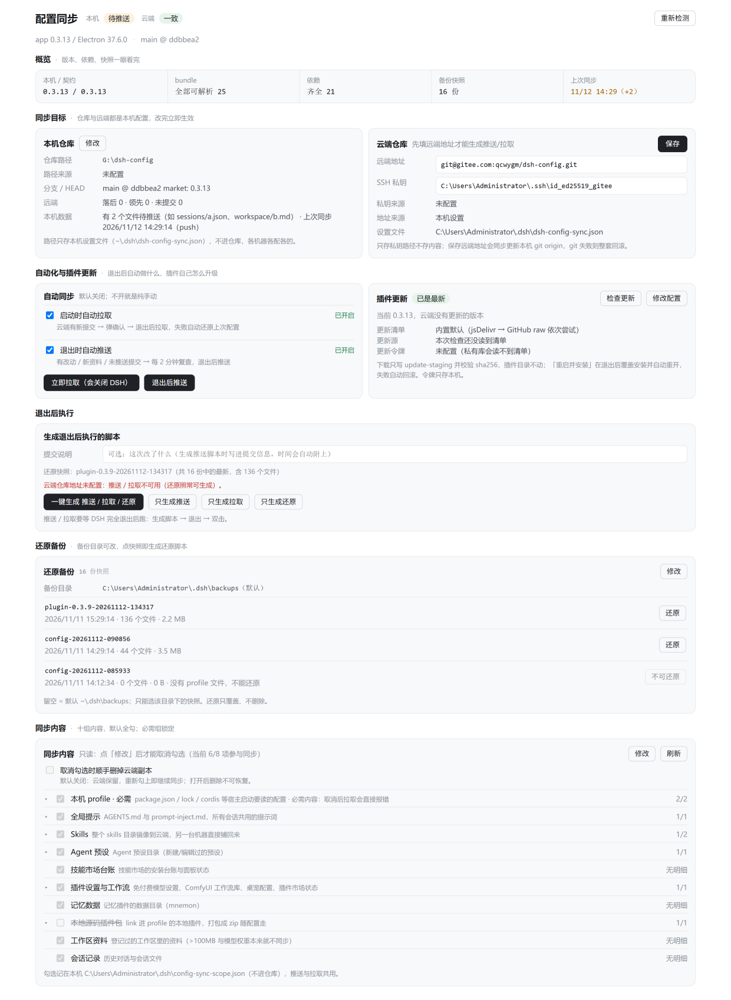

# dsh-config-sync

中文 | [English](README.en.md)

DSH 插件：左侧栏多一行「配置同步」，点开是整页体检面板；「设置 → 通用」另有一行摘要。插件**只做体检 + 备命令**，同步动作在客户端退出后由 `runtime\sync.ps1` 执行（自动同步那一路会自己拉起客户端）。



面板与宿主文案跟客户端语言走（`zh-*` → 中文，其余 → 英文），没有面板内切换开关；生成的 `.cmd` 脚本内文字固定中文。

---

## 从零开始：让第二台机器跑起来

全程两条命令，源机器推一次、目标机器拉一次。下面是从零实测走通的完整顺序（2026-11-14，隔离环境两台假机 + 本地裸库，未碰主力机）。

```
源机器 A                          远端（Gitee / GitHub / 自建）        目标机器 B
─────────────────────────────     ─────────────────────────────    ─────────────────────────────
1 装插件（tgz 或市场）                                                1 装「同版本」DSH 客户端
2 面板里填 本机仓库 + 云端地址                                        2 启动一次，让它生成 profiles\desktop
3 首次推送 = 初始化推送          ──►  仓库骨架 + 全部配置  ──►        3 装插件，面板里填本机仓库 + 同一云端地址
   （自动写 6 个执行体 + 会话/工作区）                                  4 首次拉取（先体检，会覆盖本机配置）
                                                                     5 客户端起来，工作区与会话都在
```

### 前置条件（缺一项就会卡住，实测全踩过）

| 项 | 要求 | 不满足时的表现 |
|---|---|---|
| 客户端版本 | 两台机器**同版本**（`profile\host-contract.json` 会校验） | 拉取日志 `版本不一致`，加 `-AllowVersionDrift` 才能强铺 |
| 目标机器 `.dsh` | 至少启动过一次客户端，存在 `profiles\<profile>` | `[X] 目标 profile 不存在（本机还没装过 DSH？）` → 拉取直接退出 |
| Node / Electron 执行器 | 客户端自带（`<AppRoot>\node.exe` 或 `DeepSeek Harness.exe`） | `本机没有可用的内置运行时`，会话 cwd 无法改写，**会话列表会是空的** |
| 仓库骨架 | 由源机器首次推送自动写入 | 仓库里只有 `settings\`、没有 `apply.ps1` → 目标机器跑不起来，必须重新初始化推送 |
| git | 两端都装（`git.exe` 在 PATH 或常见位置） | `找不到 git.exe` |

### 源机器 A：首次推送（初始化推送）

面板 → 「本机仓库」填一个**空目录或已有仓库** → 「云端仓库」填远端地址 → 点「初始化推送」（两边都空时按钮就叫这个）。

它会依次做：`git init` → 补 `origin` → **把插件 runtime 的 6 个执行体（`apply.ps1` / `capture.ps1` / `sync.ps1` / `restore.ps1` / `post-exit.ps1` / `dsh-sync-common.ps1`）+ `tools\fix-session-cwd.mjs` 拷进仓库根** → 写 `profile\host-contract.json`（本机客户端版本）→ `capture` 抓配置 → 提交 → `push -u origin main`。

命令行等价（隔离实测用的就是这条）：

```powershell
pwsh -File runtime\sync.ps1 push `
  -RepoRoot  <仓库目录> -DshHome <~\.dsh> -AppRoot <客户端根> `
  -WorkspaceHome <工作区根> -ProfileName desktop -SkipInstall -Force
```

隔离环境首次推送的真实产物（15 个文件、commit `3fa3780`）：

```
apply.ps1  capture.ps1  dsh-sync-common.ps1  post-exit.ps1  restore.ps1  sync.ps1  tools/fix-session-cwd.mjs
profile/package.json  profile/cordis.patch.yml  profile/host-contract.json
settings/dsh-workspaces.json
workspace/workspace-registry.json  workspace/default-workspace/notes.md
conversations/session-index.json   conversations/session_projcache/s1.json
```

### 目标机器 B：首次拉取

1. 装**同版本**客户端，**启动一次**（只为生成 `profiles\desktop`，可以马上关掉）。
2. 装插件，面板里填「本机仓库」（指向一个空目录即可）与「云端仓库」（同一个远端地址）。
3. 点「拉取」。手机界面会先列出「本机领先几个提交 / 几项未提交」，确认才动手（它会用仓库版本覆盖本机配置）。
4. 起来后检查三件事：工作区列表有、点开历史会话能回到原工作区、插件页依赖齐全。

命令行等价：

```powershell
pwsh -File runtime\sync.ps1 pull `
  -RepoRoot <仓库目录> -DshHome <~\.dsh> -AppRoot <客户端根> `
  -WorkspaceHome <工作区根> -ProfileName desktop -SkipInstall -Force
```

`-SkipInstall` 跳过 `pnpm install`（隔离/离线场景必须加，否则会尝试联网装依赖）；`-Force` 用来跳过「检测到 DSH 在运行」的保护（真机请先完全退出客户端，别用 `-Force`）。

隔离环境首次拉取的真实输出（`pull_rc=0`）：

```
[OK] 宿主版本一致（app = 0.2.2）
[OK] 已还原工作区「default-workspace」→ <B>\app\workspace\SquadLink（1 个文件，字节保真）
[OK] 工作区登记表已按 ID 合并 → <B>\home\storages\workspace.json（1 个工作区）
[OK] 会话 projcache 的 cwd 已对齐本机路径：修正 1 个
[OK] 会话数据全量还原：写入/更新 1 个文件、备份 1 个
[OK] 全部 0 个插件依赖已就位
```

### 从零验证时最容易踩的五个点

| 现象 | 原因 | 办法 |
|---|---|---|
| `参数里的 -AppRoot 对不上，已自动改用：D:\DeepSeekHarness` | `Resolve-DshAppRoot` 只认目录里有 `resources\app.asar` 或 `resources\app\package.json`；假客户端/绿色版少了这两个就退回注册表里的真实安装 | 显式传 `-AppRoot` 时确保该目录有这两者之一 |
| `[X] 已停止（未抓取、未提交）` | 检测到 `DeepSeek Harness.exe` 在跑，怕抓到写了一半的 `cordis.patch.yml` | 完全退出（含托盘）后重跑，或加 `-Force` |
| `目标 profile 不存在` | 新机器的 `.dsh` 还没被客户端初始化过 | 先装同版本客户端并启动一次 |
| `本机没有可用的内置运行时` | `<AppRoot>` 下没有 node.exe / 客户端本体 | 装完整客户端；或让 `node.exe` 可被找到，否则会话 cwd 不会被改写、会话列表为空 |
| 工作区资料到了，但 `~\.dsh\settings.json` 里的自定义键没同步 | 插件配置是**白名单制**（13 项逐个文件），不整份搬 `settings.json` | 需要同步的配置请确认它属于白名单（见「插件配置跟得走」） |

---

## 安装

```sh
# 版本号换成 Releases 页里最新的那个
dsh plugin add https://raw.githubusercontent.com/QcWyGm/dsh-config-sync/main/releases/dsh-config-sync-<版本>.tgz
```

或在 DSH「插件 → 发现 → 索引源」里添加本仓库索引（见「作为插件市场的索引源」）。第三方市场 **dshmarket 不读这份索引**，原因见同一节。

`apply.ps1` 落地时做三件事：`local-plugins\dsh-config-sync-<版本>.tgz` 解压到 `<AppRoot>\dsh-config-sync-0.1.0`；`package.json` 加一条 `link:` 依赖与一条 `dsh.profile.bundles`；`cordis.patch.yml` 加 `config-sync` 行。

## 包含什么

| 路径 | 说明 |
|---|---|
| `index.js` | 宿主半身：`/config-sync/status`、`prepare`、`settings`、`auto`、`update`、`scope`、`conflict` 路由 |
| `client.js` | 浏览器半身：侧栏行、面板、设置摘要行 |
| `cordis.patch.yml` | bundle 补丁层（`id: config-sync`） |
| `runtime/` | 退出后执行的六个 PowerShell 脚本 + `fix-session-cwd.mjs`，随包发布，装好即可生成脚本 |
| `tools/` | `selftest.mjs`、`clientcheck.mjs`、`pack-plugin.ps1` |
| `version.json` / `releases/` | 自更新清单与安装包 |

## 入口挂在哪

| 入口 | slot | 说明 |
|---|---|---|
| 左侧栏一行 | `sidebar.panellist`（`id: config-sync`） | 与「插件 / 自动任务 / 技能市场 / 记忆系统」同列 |
| 点开的面板 | `main`（`key: config-sync`） | 两条 register 必须在**嵌套 inject** 里成对完成（只 inject `main` 时向 `sidebar.panellist` register 无效） |
| 设置摘要行 | `settings.general.item` | 一行四态 chip + 展开（仓库、远端、私钥） |

## 面板显示什么

布局是「一行状态 + 一行指标 + 分区卡片」，从上往下读：

- **标题行**：`配置同步　本机 [一致/待推送/待拉取/有问题]　云端 [一致/不一致/待拉取]`。本机徽标看配置齐不齐、依赖缺不缺、有无未提交/未推送；云端**全自动**（打开面板查一次、之后每 2 分钟复查），没有手动按钮。右上角「重新检测」与「本机路径」按钮。
- **元信息行**：`app 版本 / Electron 版本 · 分支 @ 短 HEAD`。
- **指标条**：`本机 / 契约`、`bundle`、`依赖`、`备份快照`、`上次同步`（后面 `(+N)` 表示之后又写入了几个文件）。有事才在下面出现「待办」。
- **分区**：概览 → 本机路径（**默认整块不显示**，点标题行「本机路径」按钮展开，有待处理项时按钮变橙带数量）→ 同步冲突（真有冲突时才出现）→ 同步目标 → 自动化与插件更新 → 退出后执行 → 还原备份 → 同步内容 → 问题反馈。

**统一交互**：「本机路径 / 本机仓库 / 云端仓库 / 自动同步 / 插件更新 / 同步内容」都是**先只读、点「修改」才解锁**，改完「保存」，「取消」丢弃本次改动。只有"没配过"的卡（没设仓库、没设远端）强制停在编辑态且不给「取消」。

**「待推送」不只看 git**：`git status` 干净时新会话/新资料可能还躺在 `~\.dsh` 里没 capture。`sync.ps1` push/pull 成功后会写 `~\.dsh\config-sync-state.json`（`lastSyncAt`/`mode`/`head`）；`status` 的 `local` 段 stat `sessions`、`skills`、`.agent-presets`、`mnemon`、profile 五文件、登记的工作区目录，mtime 晚于 `lastSyncAt` 的计入 `local.pending`，徽标转橙。只看 mtime、不读内容；上限 20000 文件 / 1.5 秒。

**「待拉取」= 本机仓库还是空目录**（不报异常，橙色徽标 + 「执行拉取会从云端拉到这里」）。

**上次自动同步的结果**：`~\.dsh\auto-sync-result.json` 若在 15 分钟内，客户端启动即弹一条 5 秒浮层（成功/失败 + 原因 + 日志路径），同一份结果只弹一次。

## 本机仓库 / 云端仓库

- 仓库判据：目录里同时有 `apply.ps1` 与 `profile\package.json`（再有 `sync.ps1` 才算能推拉）。
- 优先级：本机设置文件 → 插件配置 `repoPath` → `DSH_CONFIG_REPO` → 常见位置探测。**配置里填的空目录同样算有效答案**。
- 四态（`repo.phase`）：`ok` 真仓库、`empty` 空目录/待首次拉取、`missing` 目录不存在、`unusable` 有别的文件却不像仓库；`repo.pushAllowed` / `repo.pullAllowed` 按它算。
- **空目录 + 云端有内容 → 只允许拉取**：推送按钮置灰，宿主 `prepare(push)` 与 `auto(push-now)` 一律 400，「一键生成」自动降级成「拉取 / 还原」。拉取会 `git init` → 补 `origin` → `fetch` → `checkout -B <分支>`（用 init+fetch+checkout 而非 clone，因为目录里可能已有 `同步-*.cmd`）。
- **两边都空 → 只允许推送，且就是「初始化推送」**：`status` 给 `repo.remoteHeads` / `repo.remoteEmpty` / `repo.mode`（`ok|await-pull|await-init`）；执行时按上面的顺序写骨架 + capture + 提交 + `push -u origin main`。
- 云端有没有内容用 `git ls-remote --heads` + 临时 bare `fetch --depth 1 --filter=blob:none` + `ls-tree -r` 数**文件数**（15 秒超时）。**探不到（离线/认证失败）就按老规矩只允许拉取**；`remoteFiles===0` 一律算「两边都空」，用 `--force-with-lease` 覆盖那个空分支（树是空的，不丢数据）。
- 只有插件生成的 `同步-*.cmd` 与隐藏项算"空"；其余文件在却不具备仓库特征 → `unusable`。
- 远端地址优先 `git remote get-url origin`，没有才回落到设置文件；SSH 私钥只存**路径**、可留空交给 `.ssh\config`。
- **没配过 = 强制设置**：卡片停在编辑态、不给「取消」，顶部红字、生成按钮禁用，宿主 `prepare` 也 400（远端缺失时「还原」不受影响）。
- 保存顺序：校验（地址只接受 `git@host:path` / `ssh://` / `https://`；私钥填了必须存在）→ 写设置 → 有 `origin` 就 `set-url`、没有就 `remote add` → git 失败回滚设置文件。
- 设置落在 `~\.dsh\dsh-config-sync.json`，跟本机走、不进仓库。

## 支持的云端平台

插件不挑托管平台：远端只校验写法，`fetch` / `push` / `pull` / `ls-remote` 全交给 git。Gitee、GitHub、GitLab、自建 Gitea/Forgejo 走同一条路。

| 项 | 说明 |
|---|---|
| 地址写法 | `git@host:owner/repo.git`、`ssh://git@host:port/owner/repo.git`、`https://host/owner/repo.git` |
| 默认分支 | 先试 `main`，没有就取远端第一个分支（老仓库 `master` 也行），拉取后自动建 tracking |
| 认证 | SSH 填私钥路径（留空交给 `.ssh\config`），脚本用 `GIT_SSH_COMMAND` + `StrictHostKeyChecking=accept-new`；HTTPS 用 Git 凭据管理器，插件不存密码 |
| 报错自检 | fetch/pull 失败时提示里的主机名取自 `origin` 真实地址；https 地址给 `ls-remote` 检查，不是 `ssh -T` |
| 单文件上限 | 分三档：源头 >100 MB 抓取时就跳过；≥95 MB 提交前从索引剔除并记一笔；50–95 MB 只警告不拦 |

私有库注意：①优先 SSH 地址；②插件**自身更新清单**默认指向作者公开仓库，改成私有库后只有 Gitee 的 raw 会被自动换成 API + token，GitHub/GitLab 私有库 raw 匿名读会失败（已知限制）。

## 有文件没同步上时：窗口末尾 + 面板常驻提示

只要出现「文件没进仓库」，三处会同时告诉你，不用翻日志：

| 位置 | 形式 |
|---|---|
| 退出后的进度窗口 | 在「同步已完成」横幅**之前**打印 `未同步的文件 N 个`：按类分组，每组最多 5 条（类名、相对路径、体积、原因），超出的给「…还有 N 个，完整清单：<路径>」 |
| 配置同步面板 | 「上次自动同步」卡底部常驻黄框：分类计数 + 最多 30 条明细 + 「文件仍在本机，只是没进仓库；下次同步自动复查」 |
| 机器可读 | `~\.dsh\sync-notices.json`（`at/mode/total/byKind/items`，四个 `byKind` 键固定）与 `auto-sync-result.json` 的 `notices` 字段 |

四类 `kind`：

| kind | 什么时候记 | 文件本身 |
|---|---|---|
| `too-large` | 超过单文件上限：抓取时跳过（>100 MB）、提交前从索引剔除（≥95 MB）、拉取时仓库里那个文件不还原 | 留在磁盘，只是不进仓库 |
| `history` | 推送前历史预检发现本地历史提交里已有超限文件 | 远端会拒收整次推送 |
| `skipped` | 按规则跳过（模型权重、`*.whl` 等）或被占用 | 留在磁盘 |
| `failed` | 单文件写入失败、会话头/projcache 修正失败、被远端拒收 | 看 `reason` |

### 推送前两道预检

1. **索引预检**：`git add -A` 之后逐个 stat 暂存文件，≥95 MB 的 `git reset -- <path>` 撤出索引、写进 `.git\info\exclude`（下次 add 不再收），其余照常提交推送——一个大文件不会拖住整次同步。50–95 MB 只警告。
2. **历史预检**：`git ls-tree -r -l HEAD` 扫已有历史，命中 ≥95 MB 就提前报「远端会拒收整次推送（不是网络问题）」，并给两条路：①面板「初始化推送」到一份新的空仓库（配置同步不需要旧历史，最省事）；②`git filter-repo` 清史后强推。**只报告，不自动改写历史。**

### push 失败归因

`git push` 的原始输出不再被一句「网络/认证失败」盖掉，按特征分类：

| 特征 | 结论 |
|---|---|
| `File <path> is X MB; this exceeds ... limit` | 文件超限（逐个列出文件名与体积） |
| `exceeds ... quota` / `repository size` / `仓库容量` | 仓库总量超限 |
| `[remote rejected]` / `pre-receive hook declined` | 远端拒收（无文件名时按通用拒收处理） |
| `Could not read from remote` / `Permission denied` / `publickey` / `Host key verification` / `Could not resolve host` / `timed out` | 网络或认证 |

### 中文路径的坑（0.3.48）

`git` 默认 `core.quotepath=true`，非 ASCII 路径会被转义成 `"workspace/DSH\347\240\264\347\224\262/..."`（**带双引号**）。0.3.47 的索引预检直接读 `& $git ... diff --cached --name-only` 的输出，于是 `Test-Path -LiteralPath` 撞上 `"` 报 `执行体调用异常：路径中具有非法字符`，整次同步在提交前就挂了。

修法：凡是要「按路径干活」的 git 查询一律走 `Read-GitLines`（内部 `-c core.quotepath=false` + cmd 字节重定向 + 按 UTF-8 读），并给逐个 stat 包一层 `try/catch` —— 单个坏名字只跳过体积检查，不再拖垮整次同步。实测真实仓库 918 条暂存路径：含引号 0 条、stat 失败 0 条；历史预检的 `ls-tree -r -l` 3222 条全部能按 `\t` 切出路径与体积。

实测（2026-11-14，隔离仓库 + 本地裸库 + 假 `pre-receive` hook）：96 MB 文件被剔除后其余照推成功、`sync-notices.json` 落盘 `too-large=1`；同一文件进历史后预检报 `history=1`；hook 回放 GitHub 报文（`File big.bin is 96.00 MB; this exceeds ...`）被正确归成「文件超限 1 个」而不是网络问题；窗口末尾汇总与面板区块读的是同一份清单。

## 工作区与会话跟着机器走

跨机可用取决于三处路径是否被换成本机值：

| 位置 | 存的是 | 换机器后怎么办 |
|---|---|---|
| `workspace\workspace-registry.json` | 每个工作区的落点，已写成 `{{APP_ROOT}}/xxx` | 拉取时展开成本机路径，工作区直接开在本机对应目录 |
| `conversations\sessions\--ws-<id>--\...\session.v4.jsonl.zstd` | 会话日志第一帧的 `cwd` | 按「本机这个工作区在哪」重写第一帧，后面的帧一字节不动（靠 Node 解 zstd，找不到执行器时**宁可不铺**） |
| `conversations\session_projcache\<sessionId>.json` | `record.identity.cwd` | 按登记表的 `sessionIds` 反查该工作区在本机的位置再改写；漏了这一步的症状是「工作区能列出来、点开历史会话指着对方机器的目录」 |

推断规则：先看登记表里该工作区的**标题/槽位/相对结构**，在本机展开成绝对路径；会话靠 `sessionIds` 认领同一个工作区，跟着那个落点走，**不靠猜盘符**。推断不出来（路径是绝对老盘符、登记表里没有对应项）就**不改**，留着让面板提示。

推送侧报告分两组：`scope: config` 是配置文件里的路径，`scope: data` 是 `workspace\` 与 `conversations\` 里还指着对方机器的记录，面板分两列展示、都能逐条采纳。

**边界**：默认工作区（`default-workspace`）**不同步**（目录名按各机 `WorkspaceHome` 编码，目标机认不出，只会留下"历史为空"的空工作区）；`models/`、`*.whl`、`*.safetensors` 与任何 >100 MB 的文件也不进仓库。

## 同步后新会话落在默认工作区

`<DshHome>\storages\workspace.json` 的 `global.defaultWorkspaceId` 决定新会话落在哪。DSH 只在本机**首次初始化**写过一次，之后同步几轮就可能停在「上次用的工作区」。`post-exit.ps1` 在**客户端完全退出之后、重新拉起之前**把它校正到默认工作区（早写会被客户端退出时的回写盖掉）。

| 项 | 说明 |
|---|---|
| 默认行为 | 找标题为 `default-workspace`、或路径以 `\deepseek-harness\default-workspace` 结尾的工作区 |
| 指定别的 | `~\.dsh\dsh-config-sync.json` 的 `defaultWorkspace` 填工作区 ID 或绝对路径 |
| 关掉 | 同一字段填 `off`（或 `none`） |
| 安全阀 | 值不同才写；写前备份 `workspace.json.bak-<时间戳>`；写完回读校验；匹配不到就不动 |
| 副作用 | 你手动切换的「默认工作区」会被下一次同步覆盖回来——不想要就设 `off` |

## 一键生成的三份脚本

「一键生成 推送 / 拉取 / 还原」可一次写三份或只写一份；仓库还是空目录时只生成「拉取 / 还原」。

| 脚本 | 干什么 | 安全阀 |
|---|---|---|
| `同步-推送.cmd` | 退出后 capture 并推到远端 | 先查客户端是否还在跑；本机仓库是空目录时拒绝 |
| `同步-拉取.cmd` | 退出后拉取并 apply | 先写明「本机领先几个提交 / 几项未提交」，输 `y` 才动手（会用仓库版本覆盖本机配置） |
| `同步-还原.cmd` | 退出后把 profile 退回某次 apply 前的快照 | 先 `-DryRun` 打印计划，按 `y` 才真写 |
| `同步-还原-<快照名>.cmd` | 同上，退回**指定那一份** | 同上；文件名带快照名，多份并存互不覆盖 |

三份都写死本机参数（仓库、AppRoot、`.dsh` 位置），双击即可。拉取与还原支持 `--yes` 免确认（自动化/远控用）；没有确认时明说「没有收到确认（y），已退出：本机什么都没改」。

提交说明可填，以 `-Message "..."` 传进 `sync.ps1`，**时间由脚本执行那刻自动追加**。还原脚本生成时若已有快照会明写 `-BackupDir`；没有则不写，交给 `restore.ps1` 运行时取最新一份（最新是空快照时自动往前找第一份含 `package.json` 的）。

## 同步冲突

拉取被本机文件挡住（同路径两边内容不同）时 git 会整批 `Aborting`。旧做法是失败就 `reset --hard` + 用快照还原配置，实测会把**已快进成功**的 HEAD 又打回旧提交，于是永远差几个提交。现在的做法**不 reset**：

1. `sync.ps1 pull` 先 `git fetch`，判定能否快进，再算交集：`git diff --name-only HEAD origin/x` ∩（本机未入库 ∪ 本机已修改）。命中就**逐文件两边都备份**、写 `~\.dsh\sync-conflicts.json`，然后 `exit 6` 停下，**仓库与配置都不动、HEAD 不回滚**。
   备份在 `~\.dsh\backups\conflict-<时间>-拉取冲突-Pull-conflict\`：`本机-Local\<路径>`、`云端-Cloud\<路径>`（`git cat-file blob` 按字节落盘，二进制不转码）、`说明-README.txt`、`清单-Conflicts.json`。任一侧字节数与源文件对不上就标未备份、面板对应按钮置灰。
2. 重启客户端后面板出现「同步冲突」卡：一行一个文件，点整行展开两侧预览；每行「用本机 / 用云端」，底部「全部用本机 / 全部用云端」；展开后还能「还原本机副本」「还原云端副本」（两份都能单独写回，不动 git 历史）。
3. 选完点「立即拉取」：`用云端` 的删掉工作区副本、`用本机` 的也先删（让 git 能快进），快进后再把 `用本机` 的从备份写回，于是变成一次本地改动，下次推送带上。

粒度只有「逐项 用本机 / 用云端」＋「单项从备份还原」，不做预览内编辑或手工合并。

接口：`GET/POST /config-sync/conflict`（GET 读清单，每项带 `localSaved`/`cloudSaved`；POST `{items:[{path,choice}]}` 存选择、`{action:'restore',path,side}` 单项还原、`{action:'reset'}` 放弃清单）。还原按清单里记录的 `repo` 路径写，改过 `repoPath` 也不会写错仓库。

## 还原备份

面板「还原备份」卡（排在「退出后执行」之后、「同步内容」之前）：上面一行是备份目录（默认 `~\.dsh\backups`，`apply.ps1` 每次拉取/落地前都会打一份快照），下面列出该目录下所有快照——名称、时间（带「3 分钟前」）、插件数、能否还原。

- **列表不显示体积**：每份快照是整份 profile（几千文件），旧版每次刷新都逐个 `stat`，92 份 / 4.8 万文件实测 7.7 秒，`/status` 拖到 11 秒、前端 fetch 撑不住就显示「读取失败」。现在只给名称/时间/插件数/是否可还原；远端探测改成「缓存 5 分钟 + 每次最多等 2.5 秒 + 装载时预热」，前端 status 带 15 秒超时和 3 次自动重试。实测 status 8.0 秒 → 0.35 秒（中位，20 次）。
- **「立即还原」是个流程**：点某行 → 宿主取**差异预览**（撤走哪些插件、移走哪些新增文件、覆盖哪些文件、要重装什么）→ 「确认还原」才排队 → 客户端正常退出 → `post-exit.ps1` 弹可见进度窗口跑 `restore.ps1 -RollbackToPoint` → 结果写 `auto-sync-result.json` → 自动重启。不用自己退客户端、双击 `.cmd`、输 `y`。
- **时点还原 = 回到那个时间点**：快照之后新增的文件移进 `backups\manual-<时间戳>\rollback\files`；之后装上的插件，junction 只删链接（不穿进链接删实体）、实体目录移进 `rollback\plugins`；每项写进 `rollback\rollback-manifest.json`，全部可再还原。动手前先把当前配置另存 `manual-<时间戳>`。
- **谁算「快照之后装上的插件」**：以还原后 `package.json` 的 `dependencies` 为准，`node_modules` 里不在其中的直接子目录（含 `@scope/包`）撤走。
- **地址可自己改**：点「修改」填绝对路径（如 `D:\DSH备份`），存在 `~\.dsh\dsh-config-sync.json` 的 `backupRoot`；「恢复默认」清回 `~\.dsh\backups`。
- **三类备份各有还原入口（0.3.49 起）**：备份根 `~\.dsh\backups` 是多用途共用的，面板按内容分成三类，每类都能一键还原：
  - **配置快照**（`config-*` / `manual-*`，顶层 `package.json` 且 `name: dsh-profile-*`）→「立即还原」，做时点回退。
  - **插件备份**（`plugin-<版本>-*`，含 `runtime\` / `client.js` 或只有一层 `dsh-config-sync-<版本>\`）→「回滚插件」：先把当前插件整份备份成 `plugin-<当前版本>-<时间戳>`，再用目录合并复制写回插件安装目录（`Copy-Tree` 逐层合并，不会出现 `runtime\runtime`；这点 0.3.49 实测踩过）。
  - **会话备份**（`session-corrupt-*`，顶层全是 `--<路径编码>--`）→「还原会话」：把会话目录写回 `~\.dsh\sessions`，同名目录先整份留底到 `backups\session-<时间戳>`。
  - **认不出类型的**（冲突对照、手工拷来的）→「手动还原」：弹出备份路径、里面有什么、以及三类常见目标位置，按提示手动拷；不再有「不可还原」的死按钮。
- **分类判据不能只看有没有 `package.json`**：profile 的 `package.json` 里**也有** `dsh` 字段（`dsh.profile.bundles`），拿 `dsh` 判插件会把整份配置快照误判成插件备份（实测 `config-*`/`manual-*` 8+2 份全中招）。现在顺序是：`name: dsh-profile-*` 或 `dsh.profile` → 配置；`name: dsh-config-sync` → 插件；再按顶层内容和目录名前缀兜底。空目录（半截安装残留）标「空备份」不给按钮。
- **只认能用的快照**：配置快照没有 `profile\package.json` 的（新机器首次拉取时本机无配置可备份）标「空备份」置灰；宿主 `restore-backup` / `restore-preview` / `restore-now` 共用 `resolveSnapshotDir` 同一套校验，认不出类型会直接拒绝并提示走手动还原。
- **只在这个目录里选**：面板传来的必须是备份根之下真实存在的一份快照（越界、相对路径、含引号换行直接报错）。

## 插件配置跟得走

新机器同步完发现「配置没了」，多数不是拉取失败，而是**这些配置从来没进过仓库**。插件配置组覆盖 13 项：

| 仓库路径 | 本机来源 |
|---|---|
| `settings\our-free-model.json` | `~\our-free-model\settings.json`（运行时字段已归一，不会每轮都「有改动」） |
| `settings\comfyui-workflows.json` | `~\data\dsh-comfyui\workflows.json` |
| `settings\dsh-pet-main-config.jsonc` | `~\dsh-pet\main-config.jsonc` |
| `settings\dsh-pet-memory.json` | `~\dsh-pet\memory.json` |
| `settings\dsh-market-state.json` | profile 下 `.dsh-market\state.json` |
| `settings\our-free-model-picks.json` | `~\our-free-model\picks.json` |
| `settings\dsh-im-interface-language.json` | `~\integrations\dsh-im\interface-language.json` |
| `settings\dsh-qq-config.json` / `dsh-qq-workspaces.json` | `~\integrations\dsh-qq\config.json` / `workspaces.json` |
| `settings\redteam-preset-declare.json` | `~\redteam\preset-declare.json` |
| `settings\task-board-ledger.json` / `task-board-scheduler.json` | `~\task-board\ledger-v2.json` / `scheduler-v2.json` |
| `settings\dsh-workspaces.json` | `~\storages\workspace.json`（新机器「工作区不见了」就是它没同步） |

**这是白名单，不是整份搬**：`~\.dsh\settings.json` 本身不进仓库，自由格式的自定义键会被丢弃（隔离实测确认过）。**排除**：凭据与运行时状态——`channel-pack`（含 `token-ledger.json`）、`workbuddy-vault`、`dsh-purge`、`stats`/`feed`/`catalog`/`availability`、`integrations\dsh-qq\bots\<bot>\state.json`、会话缓存。

### 带本机路径的配置：占位符 + 换机确认

| 占位符 | 含义 |
|---|---|
| `{{APP_ROOT}}` | 客户端安装目录 |
| `{{DSH_HOME}}` | `.dsh` 配置目录（一般 `%USERPROFILE%\.dsh`） |
| `{{WORKSPACE_HOME}}` | 工作区根目录 |
| `{{ROOT:<key>}}` | 用户自选目录（ComfyUI 模型目录、代理路径等），键值在面板里定 |

- `capture.ps1` 写仓库**前**归一：本机根 → 占位符。同一路径的 4 种写法（原生反斜杠 / JSON 双反斜杠 / 正斜杠 / JSON 转义斜杠）都认；替换按根长度降序（工作区根在安装目录之下，先换长的才不错位）。
- 仓库里一律**正斜杠**（`{{APP_ROOT}}/mnemon`），避开 JSON 反斜杠转义。
- `apply.ps1` 落地**前**展开：占位符 → 本机路径。

### 路径确认：拉取后由你选，选过就不再问

- 首次同步在 `~\.dsh\config-sync-roots.json` 落一份本机根（探测值），本机私有、不进仓库。
- 某机器缺某个根（展开不掉）时，`apply.ps1` **跳过那个文件不写**，记进 `~\.dsh\config-sync-pending-paths.json`。
- 面板「本机路径」卡列出这些项，填好本机路径 → 保存 → 重新拉取一次就写进去；确认值优先于自动探测，之后不再问。**宁可不写**，也不把 `{{ROOT:xxx}}` 字面量写进配置。

### 两条体检

**推送之后（capture 末尾）**：扫仓库里的**配置类文件**（`settings\*.json`、`profile\*.json`、`skills\`、`presets\`、`prompt\`、顶层 json；`conversations/workspace/mnemon/storages-record` 是会话与运行时数据，换机器本来就不该一致，不参与），把**不属于任何已确认根**的绝对路径抓出来，写 `~\.dsh\config-sync-absolute-paths.json`（带 `machine` 与写它时各根的值），控制台 `Warn` 一句。**不拦提交**。

**这份清单只对「接收方」有意义**（0.3.43）：清单是推送时写的，本机推出去的路径在本机当然都在，摊在本机面板上只会让人以为出了问题（实测 50 条里有 40 多条是 `conversations\session_projcache` 的会话缓存）。现在面板先比清单里的 `machine` 与本机机器名：

- **清单来自本机** → 不显示、不计入告警数（`status.localPaths.absolute` 归 0）。
- **清单来自另一台机器**（本机是接收方，刚要拉或刚拉完）→ 显示「这份配置是 `<机器名>` 推送的」，并**逐条给推荐目录**：先拿报告里记着的对方根值做前缀映射（`F:\DSH\SquadLink` → 本机 `<APP_ROOT>\SquadLink`，保留原大小写）；没有根可映射就按最后一级目录名在本机几个根、用户主目录、桌面、各盘根下找同名目录；都没有就明说「本机没有等价目录」。
- 每行一个「采纳」：点一下把推荐目录记进本机自选目录（`{{ROOT:<key>}}`），下次推送起这些路径变成占位符，哪台机器拉取都换回自己的值；已采纳的行显示「已采纳」。
- 顺带过滤正则误匹配：`s://1v3.apiipu.com/...` 以前被当成 `s:` 盘符，现在含 `://` 直接跳过。

**拉取之前（apply 写 settings 前）**：铺配置是整份 `WriteAllText` 覆盖，改完路径没推送就点拉取，改动会被静默盖回去。所以覆盖前先比一次：本机现状（归一化成占位符、CRLF 拉平成 LF、`our-free-model.json` 的 `catalogSyncedAt/reloadedAt/reloadCount` 一起置 0）与仓库版本不一样，就记进 `~\.dsh\config-sync-overwrite.json`，面板提示「有 N 份配置被仓库版本覆盖（本机改动已先备份）」。想保住本机改动：**先推送，再拉取**。

### 「本机路径」卡怎么用

- **平时整块不渲染**，入口只有标题行的「本机路径」按钮。
- **三类都算告警**：待确认路径、仓库里有根外绝对路径、上次拉取覆盖了本机配置——`status.localPaths.alert` 给合计，按钮变橙显示「本机路径 · N 项告警」。
- **默认只读**：三行根用等宽字显示当前值与对应占位符；自选目录同样展示。点「修改」才变输入框。
- 编辑态多三件事：每个根右边「用探测值」；每个自选目录右边「删除」；底部「新增目录」填键名 + 路径（键名只接受字母数字 `_ . -`）。
- 这一卡的值**优先级最高**：保存过的根压过脚本探测值（`Get-SyncRoots` 里 roots.json 优先、只补空值）。填错不是"没生效"，而是真的按错值展开成死路径。

## 问题反馈：走 GitHub Issue

**GitHub Issue 是唯一真源**，不再往配置仓库塞 json：

1. 填标题 + 详情 → `POST /repos/QcWyGm/dsh-config-sync/issues`，label `feedback`，正文末尾自动附环境块（插件版本、机器名、时间、平台、安装目录、配置仓库路径）。
2. 列表直接读 Issue（`state=all&labels=feedback`），点标题去 GitHub 网页。
3. 点「已解决」→ `PATCH issue {state:'closed'}`。
4. 顶上一行连接状态三态：`已用 xxx 登录` / `令牌不属于所有者（只能读和提交）` / `匿名读取（提交走浏览器）`。

- **读不需要令牌**：仓库公开，匿名请求能读（60 次/小时·每 IP）；有令牌才走 5000 次/小时。
- **没令牌也能提交**：把标题、正文、环境块预填进 GitHub 新建 Issue 页面，浏览器里登录着的话点 Submit 即可。
- **关单只有仓库所有者能点**：先 `GET /user` 认令牌归属，`login` 与仓库所有者不一致就 403。
- **令牌不用手填**：默认从本机 git 凭据 `git credential fill` 取一次，存 `<dshHome>\config-sync-gh.json`（本机私有、不进仓库）；取不到才需要粘一次，粘完立刻用 `/repos/{repo}` 验一遍。
- **断网不丢**：建 Issue 失败进 `config-sync-feedback-outbox.json`，联网后点「补发」逐条建，成功的自动出队。
- 列表头上「未解决 / 已解决 / 全部」+ 搜索框（编号、标题、作者、正文、环境块都参与），筛选全在本地做，不占匿名限额。

## 卸载残留自动清理

宿主卸载插件时**不删 `profile\node_modules` 里那条 junction**。`apply.ps1` 每次落地巡检一遍，只删**三条同时成立**的链接：①`LinkType` 是 Junction/SymbolicLink；②所有 Target 都不存在；③不在 `package.json` 的 `dependencies` 里。用 `Directory.Delete` 只删链接本身、不顺着链接动目标。

**顺手清插件备份**：与在用版本**相同**的 `.bak-<时间戳>` 直接删；版本不同的只留最新一份；主目录已不存在的备份保留（可能是唯一回滚点）。部署判据比归档内 `package.json` 的 version 与已部署目录的 version（之前比 mtime，被 `git checkout` 刷时间害得每轮误判「有新版本」）。

## 同步内容勾选

面板最下面「同步内容」卡，十组逐组列出、**默认全勾**；点一行展开明细，组和单项都能取消勾选——取消后**推送不再抓、拉取不再还原**，重新勾上继续同步（推拉共用同一份勾选）。

| 组 | 云端目录 | 明细项 |
|---|---|---|
| 本机 profile | `profile/` | package.json / lock / cordis 等（整组开关，**必需不可取消**） |
| 提示词 | `prompt/` | `AGENTS.md`、`prompt-inject.md` |
| 技能 | `skills/` | 每个技能目录 |
| 预设 | `presets/` | 每个预设 |
| 技能市场台账 | `storages-record/` | 两个台账 json |
| 插件配置 | `settings/` | 13 个文件，可单独排除 |
| 记忆 | `mnemon/` | 整目录 |
| 本地插件 | `local-plugins/` | 每个 link 插件 |
| 工作区 | `workspace/` | 每个登记的工作区 |
| 会话 | `conversations/` | 每个工作区对应的会话 |

- 先只读，点「修改」才解锁勾选，改完「保存」才写文件。
- 勾选记在 `~\.dsh\config-sync-scope.json`，跟本机走、不进仓库；只留与默认不同的项，删掉就恢复全勾。
- 跳过**两侧都生效**：`capture.ps1` 不抓、`apply.ps1` 不还原；`-PruneSkills` 也不会把"勾掉的本机技能"当多出来的项删掉。
- 另有开关「取消勾选时顺手删掉云端副本」，**默认关**；打开后取消勾选会真的删仓库里的对应目录（删除不可恢复）。
- **`本机 profile` 是必需内容**：仓库里没有 `profile\package.json` 或 `cordis.patch.yml` 时拉取会 `[X] 仓库内容不完整` 退出；`profile\host-contract.json` 还是两台机器的版本一致性校验。

## 自动同步 / 自动推送（默认关）

| 开关 | 行为 |
|---|---|
| 启动时自动拉取 | 启动 8 秒后只读 `git fetch` 比对；落后 > 0 → 系统确认框 → 选"是"**当场把客户端整族退出**（实测 5 秒内进程归零）→ 可见窗口跑拉取 → 拉完自动重启 |
| 退出时自动推送 | **三个来源任意命中就排队**：本地领先提交、未提交改动、本机资料比上次同步新（新会话等）。启动后每 2 分钟复查，已排队不重复拉起；等 DSH 完全退出后才 push，推完自动重启 |

- 动手由插件拉起 `runtime\post-exit.ps1 -Phase wait`（**隐藏**）盯退出；真退了才用 `-WindowStyle Normal` 起 `-Phase run` 的**可见**窗口，标题「DSH 配置同步 · 拉取/推送」。**排队期间不弹窗**。
- 仓库还没就位（含空目录）时首检直接跳过，且不记成"检查失败"。
- **拉起方式**：`detached: true` 起 powershell 在 Windows 上会当场退出（日志一行都没有），改成短命 powershell 用 `Start-Process -PassThru` 起独立进程；`spawn()` 失败是异步的，所以要等 launcher 退出码、拿不到 pid 就如实失败，并写 `~\.dsh\logs\auto-sync-launch.log`。
- **等退出不能只看 pid**（插件跑在子进程里）：改成按进程名；「点了关闭但进程赖着不走」（实测 7 个进程 `hwnd=0` 存活 1 分钟以上）也认——活过 60 秒、无可见窗口持续 16 秒 → 结束残留进程再同步。
- **一个时刻只跑一次同步**：`~\.dsh\auto-sync.lock` 记 pid，后来者读锁（同种复用，不同种先结束那个没开工的等待进程再改排）。
- **退出客户端用整族结束**：`taskkill /PID` 不带 `/F` 对 Electron 主进程无效，改 `/IM "DeepSeek Harness.exe"`，3.5 秒后再补 `/F`。
- **重启前清环境变量**：继承的 `ELECTRON_RUN_AS_NODE` / `ELECTRON_NO_ATTACH_CONSOLE` / `NODE_OPTIONS` / `NODE_PATH` 会让客户端"起来就退"，清掉后一次成功；启动后数进程、没活等 8 秒重试，最多 3 次。
- **拉取失败自动回滚**：`git reset --hard` 回原提交 → 用这次 apply 写盘前刚建的 `backups\config-<时间戳>` 跑 `restore.ps1` → 结果写日志。
- **进度窗口收尾**：跑完不自动关闭，把「同步已完成 / 日志路径」留在屏幕上，按键或点 × 才退出。客户端是**在这之前**由 `explorer.exe` 代启的，没有父子关系，窗口留多久都不会带走客户端。
- 退出码：`0` 完成、`2` 等待超时、`3` 缺 sync.ps1、`4` 重启失败、`5` 同步失败（pull 已尝试回滚）。

## 插件自更新

面板「插件更新」卡显示本地版本、云端版本和一行状态；清单与安装包都在公开仓库（`version.json` + `releases/dsh-config-sync-<版本>.tgz`，只读几百字节，不拉整包），服务端缓存 30 分钟，挂载时查一次、之后每 30 分钟复查。

| 状态 | 含义 |
|---|---|
| 绿色「已是最新」 | 本地版本 ≥ 清单版本 |
| 橙色「有新版本 x.y.z」 | 清单版本更大，附说明和「下载更新」按钮 |
| 橙色「已下载，待安装」 | 包已下到 `~\.dsh\update-staging\`（插件目录一字节没改），点「重启并安装」生效 |
| 橙色「已安装，待重启」 | 老路径上（运行中安装过但没重启） |
| 红色「检查失败」 | 清单读不到，附「检查更新」逐个列出每个源的失败原因 |

- **清单多源按顺序试**：`gh-proxy.com` → `ghfast.top` → GitHub raw（国内直连 raw 常不通，而宿主 `fetch` 是 Node 内置实现、**不读系统代理**）。下载安装包按「读到清单的那个源 → 其余源」依次试。单次 30 秒超时。
- **别拿 jsDelivr 当清单源**：它对 `@main` 这类分支别名缓存很久，实测发版后仍返回上一版，让「有新版本」晚几个小时才出现。
- **私有库要填令牌**：更新相关配置都在「插件更新」卡里；填了令牌后清单与包改走 Gitee API raw 端点（`?ref=main&access_token=…`，分支用 `ref` 传、不能写进路径）；令牌只存本机，不进仓库，留空保存=不改动已存令牌，另给「清除已存令牌」。
- **下载与安装分开**：点「下载更新」只把包下到 `update-staging` 并校验 sha256，宿主不碰插件目录（页面不会跳走）；下载完按钮变「重启并安装」，点它才退出 → 备份旧目录（`~\.dsh\backups\plugin-<旧版本>-<时间>`）→ 覆盖安装 → 自动拉起，全程只重启一次。
- 为什么不再运行中安装：0.3.4–0.3.6 是「DSH 不退出直接覆盖插件目录」，实测会让宿主把当前面板卸载掉（用户看到"更新到一半页面自己跳走了"）。`POST {action:'install-live'}` 仍留给 CLI，界面不再用。

## 作为插件市场的索引源

仓库根的 `market-index.json` 就是一份可直接用的 DSH 市场索引（`format: 1`，`source.type: git` + 40 位 commit）。索引地址：

```
https://raw.githubusercontent.com/QcWyGm/dsh-config-sync/main/market-index.json
```

在 DSH「插件 → 发现 → 索引源」填入即可。**前提**：这是宿主官方发现页（`@deepseek-ai/dsh-plugin-market`）的索引源，需要 profile 启用官方 `@deepseek-ai/dsh-experimental-plugin-market-bundle`。

**dshmarket 里搜不到自建索引，是正常的**：dshmarket 的列表只来自它自己的精选目录（`awesome-dsh-plugin.com/plugins.json`，国内走 npm 的 `dsh-plugin-catalog`），源码里没有自定义索引源这条路，安装也被限定在「该目录列出的来源」。要出现在那里，只能向 [awesome-dsh-plugin](https://github.com/awesome-dsh-plugin/awesome-dsh-plugin) 提 PR 收录。

> **收录后的可见性**（2026-11-13 实测）：PR `#14762` 已 MERGED，条目 `data/plugins/QcWyGm__dsh-config-sync.yml` 已进站点正本（`plugins.json`，`updated: 2026-11-13`，10974 条，含 `QcWyGm/dsh-config-sync`）。但客户端取源顺序是「站点正本 → 地区 npm 源 → jsDelivr 兜底」：13.8 MB 正本下载超时后落到 jsDelivr 镜像，而镜像（`dsh-plugin-catalog` npm 包每天 UTC 05:19 重建一次）还停在 `2026-11-12` / 10778 条、**不含** QcWyGm。所以「收录完了却搜不到」＝**镜像滞后**，不是代码问题；等当天目录包重建 + 缓存失效，或重启客户端让它重读，就会出来。用 CLI 强制刷新可立刻验证：

```powershell
node ~\.dsh\.dsh-plugin-market\market-core.mjs catalog --profile desktop
# ok=true, source=official, fromCache=false, version=2026-11-13, count=10974
```

> 同名冲突提醒：目录里 `dsh-config-sync` 有两条——`QcWyGm`（`github:QcWyGm/dsh-config-sync`，category git）与 `bxzfxl`（`@liangfengqi/dsh-config-sync`，category tools，downloads 843），搜索时会并排出现。

升级流程：改代码 → `pwsh -File tools\pack-plugin.ps1` 打包（自动把 sha256 回填 `version.json`）→ 改 `version.json` 的 `version` / `notes` → 把 `market-index.json` 里那条的 `version` 与 `commit` 换成新提交 → 推送。索引只引用 commit，旧版本随时能装回。打完包先跑 `node tools\selftest.mjs <仓库路径>` + `node tools\clientcheck.mjs`。

## 接口与路径

| 接口 | 说明 |
|---|---|
| `GET /config-sync/status` | 体检 JSON（`repo.*`（`source/configured/phase/empty/remoteHeads/remoteFiles/pushAllowed/pullAllowed`）、`remote.*`、`backup.*`、`local.{lastSyncAt,pending}`、`auto.lastResult`、`conflicts`、`localPaths`） |
| `POST /config-sync/prepare` | `{action:'push'\|'pull'\|'restore'\|'restore-backup'\|'all', message?, backupDir?}`；空目录上按云端文件数分流 |
| `POST /config-sync/settings` | 校验 → 写设置 →（地址变了才动 git），失败回滚并 400 |
| `POST /config-sync/auto` | `{action:'check'\|'pull-now'\|'push-now'\|'restore-preview'\|'restore-now'\|'cancel'}`，都不带 `/F` 关闭客户端（走正常退出，配置能存下来） |
| `GET/POST /config-sync/update` | `{action:'check'\|'install-live'\|'restart'\|'apply'}` |
| `GET/POST /config-sync/scope` | 十组同步范围读写 |
| `GET/POST /config-sync/conflict` | 冲突清单与选择 |

跨站请求 403。客户端只 `fetch` 这几条，不 import 任何 `@deepseek-ai/dsh-client-*`，样式只用 `--dsw-alias-*` token。

路径：仓库按上面的优先级；客户端根 `config.appRoot` 优先，留空由插件自身位置推出，换机不用改；`.dsh` 为 `config.dshHome` → `%DSH_HOME%` → `~\.dsh`。本机私有文件：`config-sync-roots.json`、`config-sync-pending-paths.json`、`config-sync-absolute-paths.json`、`config-sync-overwrite.json`、`config-sync-scope.json`、`config-sync-state.json`。

**边界**：`capture` 要读 `cordis.patch.yml`，DSH 运行时这文件正被应用持有，抓到的是半截状态；`apply` 写完以后，DSH 退出时又会回写覆盖。所以边界固定为：判断该跑什么、把命令写好，退出 DSH 后执行。

## 生成器里已经堵掉的坑

都是**在新机器上真跑一遍**才暴露的：

| 坑 | 处理 |
|---|---|
| cmd 的 `echo` 吃 `< > \| & ^ %` | 动态文案全过 `echoSafe()`：`%`→`%%`，特殊符号前加 `^` |
| `chcp 65001` 后 `set /p` 读不到重定向输入 | `--yes` 免确认 + 无确认时明确回执 |
| 新机器分支没有 upstream，`pull --ff-only` 报 *no tracking information*，PS 5.1 包成 NativeCommandError 后继续走 | 先探 upstream，没有就 `pull --ff-only origin <branch>` 再 `set-upstream-to`；push 带 `-u` |
| `GIT_SSH_COMMAND` 少了 ssh.exe 本体 → `/usr/bin/sh: - : invalid option` | 四分支：有 `core.sshCommand` 照用；找到 `ssh.exe` 写完整命令；只有私钥就不设变量；无私钥交给 `.ssh\config` |
| 客户端 asar 打包时按路径找 AppRoot 全落空、bundle 全误报缺失 | `isAppRoot` 认 `app\package.json` **或** `app.asar`；版本与 bundle 从 asar 定向取（PS 5.1 `ConvertFrom-Json` 2 MB 上限，5.7 MB 头只能按 entry 偏移直读），判不了就当"不知道" |
| 插件目录已存在就跳过部署，tgz 更新了本机还是旧代码 | 比归档内 `package.json` version 与已部署目录 version（之前比 mtime，被 `git checkout` 刷时间害得每轮误判） |
| 开了"退出时自动推送"却什么都不发生 | 两个叠因：①排队判据只看 `ahead > 0` → 改成三个来源都算 + 每 2 分钟复查；②`spawn` 假成功 → 改 `Start-Process` + 等退出码 + 写日志 |
| 空目录被当成"仓库坏了"，推送按钮可点但必失败 | 按 `repo.phase` 分四态，三层都拦住 |
| 「云端有没有东西可拉」看分支数 → 树被删空了仍判「有内容」，初始化推送入口永不出现（实测 Gitee 98 个提交、最新树 0 文件） | 判据换成**分支树里的文件数**：`ls-remote --heads` 数分支，有分支才临时 bare `fetch --depth 1 --filter=blob:none` + `ls-tree -r`；`remoteFiles===0` 算「两边都空」，用 `--force-with-lease` 覆盖空分支 |
| 拉取整份覆盖 settings，改完没推送就拉取 → 被静默盖回 | 覆盖前比对（占位符归一 + CRLF 拉平 + `our-free-model.json` 三个时间戳置 0），不同就写 `config-sync-overwrite.json` 并提示 |
| 同步后**新建会话直接失败**：`failed to create session … corrupt Zstandard session log: invalid frame magic at byte 186` | DSH 写的首帧**带 4 字节 content checksum**（帧头描述符 FHD 的 bit2），二分找「最小可解前缀」时解压器对**去掉 checksum 的前缀**照样成功 → 帧尾算短 4 字节；写回把旧 checksum 留成垃圾，DSH 读第二帧就撞上。改成：按 FHD bit2 补 4 字节 → 再以「下一帧帧头」校正 → 写回前自检（首帧 cwd 生效 + 新首帧末尾必须是下一帧帧头），不过不落盘；遇到历史残留尾巴顺手丢掉自愈 |

## 自检

- `node tools\selftest.mjs <仓库路径>`：假 ctx 拉起宿主半身，打 status、生成脚本、断言 JSON 与落地文件；会先备份仓库根已有的同名 `同步-*.cmd`，断言完原样还原。**必须显式传仓库路径**。
- `node tools\clientcheck.mjs`：假 `__ModuleLoader__` + react 替身跑客户端半身，断言模块能加载、`apply()` 三处注册成功、`inject` 返回回收函数、组件在无数据下渲染不抛。
- `pwsh -File tools\pack-plugin.ps1`：打包并把 sha256 回填 `version.json`。**必须用 PowerShell 7**（脚本是无 BOM UTF-8，5.1 按 GBK 读会把中文认错）。

## 实测记录

### 2026-11-14（二）：会话日志首帧 4 字节残留，新建会话 500

同步过一次之后，客户端点「新会话」直接弹 `新建会话失败：gateway/internal: failed to create session: SessionQueryError: stored session "…" is corrupt … invalid frame magic at byte 186`——一个历史会话的日志坏了，整个会话库的校验跟着失败，所以连新会话都建不出来。

| 环节 | 结果 |
|---|---|
| 现场 | `~\.dsh\sessions\--D-DeepSeekHarness-DSH~7834~7532--\session-58db748a…\session.v4.jsonl.zstd`，423 字节，mtime 是 11-13 那次同步，不是当天 |
| 字节解剖 | zstd 帧头 `28 b5 2f fd` 出现在 0 / 190 / 343；DSH 认为首帧止于 **186**，186..189 是 4 字节垃圾，真正的第 2 帧起点在 190 |
| 根因 | 首帧解压是 210 字节（header 行 + 结尾换行），二分得到的「最小可解前缀」= 186，而帧尾实际是 190：DSH 首帧带 4 字节 content checksum，解压器对缺这 4 字节的前缀同样返回成功。`rest = buf.subarray(186)` 于是把旧 checksum 当正文，写回后 186..189 永久残留 |
| 影响面 | 扫 `~\.dsh\sessions` 下 17 个 `session.v4.jsonl.zstd`：真正的坏文件 1 个（带空洞）；另 1 个被判误报，复核是**带 checksum 的正常 5 帧文件**（帧头 0/197/380/479/559），已按备份原样还原 |
| 数据修复 | 备份到 `~\.dsh\backups\session-corrupt-<stamp>` → 删掉 4 字节空洞（423 → 419）→ 复扫 bad=0；首帧 cwd 保留、第 2 帧（269 字节）可解 |
| 代码修复 | `firstFrameEnd` 按 FHD bit2 补 4 字节并以「下一帧帧头」校正；首帧改为**整段解压文本替换 cwd 后重压**（原来只重压 header 一行，首帧有追加行会丢）；**先自检后落盘**；遇到历史残留尾巴自动丢掉 |
| 隔离验证 | 用真实 checksum 多帧样本改 cwd：帧结构完整（0/169/352/451/531 全可解）；幂等复跑 `alreadyOk=1`；喂入带空洞的坏文件一次修好（402 字节，帧头 0/169/322） |
| 结论 | 会话日志只会「缺内容」不会「内容错」，所以删空洞比重新压缩安全；helper 现在宁可跳过报错也不写坏后续帧 |

### 2026-11-14：两台机器从零跑通（隔离环境）

假云端裸仓库（`git init --bare -b main`）+ 两套假客户端根（`A\app`、`B\app`）+ 各自独立 `.dsh`。全程不碰主力机目录，可反复重跑。

| 步骤 | 结果 |
|---|---|
| A 机首次推送 | 自动写 6 个执行体 + `tools\fix-session-cwd.mjs` + 版本契约；capture 抓到 8 处变更；提交 15 文件、推到 bare 的 `main`（`push_rc=0`） |
| 仓库侧占位符化 | `workspace\workspace-registry.json` 的 path 写成 `{{APP_ROOT}}/workspace/SquadLink` |
| B 机首次拉取（未装客户端） | `[X] 目标 profile 不存在` 退出（`pull_rc=1`）——**新机器必须先装并启动一次客户端** |
| B 机补 profile 后拉取 | `pull_rc=0`：工作区还原到 `B\app\workspace\SquadLink`（字节保真）、登记表合并成 B 的 `storages\workspace.json`（path 是 B 路径）、bundle 1 项可解析 |
| 无 Node 执行器时 | 日志 `本机没有可用的内置运行时`，会话 cwd 不改写（会话列表会是空的）；补一个可用 `node.exe` 后修复生效 |
| settings 语义 | `~\.dsh\settings.json` 里的自定义键**不同步**（白名单制，只搬那 13 个文件） |
| **顺手抓到两个 bug** | ①`fix-session-cwd.mjs` 用 `next.length === text.length` 判"内容没变"——两台机器路径等长时（`D:\...` ↔ `E:\...`）必然误判，表里返回 `projAlreadyOk=1` 而文件里 cwd 仍指源机；改成 `next === text`。②`apply.ps1` 第 4 步只按 `$cwdMap` 判断，仓库里只有 projcache、没有 sessions 时整段跳过，projcache 修复永远不执行；改成 `$cwdMap.Count -gt 0 -or $projMap.Count -gt 0`。两处修完：`projFixed=1`、拉取后 cwd 正确指向本机 |

### 2026-11-11：单机隔离环境（装插件 → 拉取 → 推送 → 还原）

| 步骤 | 结果 |
|---|---|
| 装插件、开面板 | 三道路由都注册；未配置时 `repo.path` 为空不静默回退，推送被 400 拦 |
| 配仓库 / 云端 | 200，路径落进本机 `.dsh\dsh-config-sync.json`；无 origin → `git remote add` |
| 生成三份脚本 | 落在仓库根，`-AppRoot` 指向该机客户端根，带 `--yes` 与 `y/N` 守卫 |
| 首次拉取 | 首次补 upstream → `Already up to date` → 备份 11 文件、铺 436 个 → `pnpm install` 21 个插件 → 25 个 bundle 全部可解析 |
| 工作区 / 会话 | 资料落在假客户端根；登记表路径展开成本机路径；空工作区补建成空目录；会话目录名按本机路径重算的编码逐字一致 |
| 推送 / 还原 | 推到假云端；还原先 `-DryRun` 出计划，`--yes` 后自保 `manual-<时间戳>` 再写回 |
| 退出后同步 | `post-exit.ps1` 五个退出码（0/2/3/4/5）全部复现 |
| 空目录语义 | `repoPhase` 八种形态判定全对（含 8.3 短名路径）；空目录跑 `push` 被拦（退出码 1、未生成 `.git`），跑 `pull` 自动 `init → fetch → checkout main` |

真机部分另记两条：`{"action":"pull-now"}` 时 `DSH 7→0` 用 5 秒、+10 秒出现可见窗口、拉完自动 `0→4→7`；开 `autoPush` 后点关闭，7 个进程 `hwnd=0` 不退，16 秒后强制收尾并推送成功。
